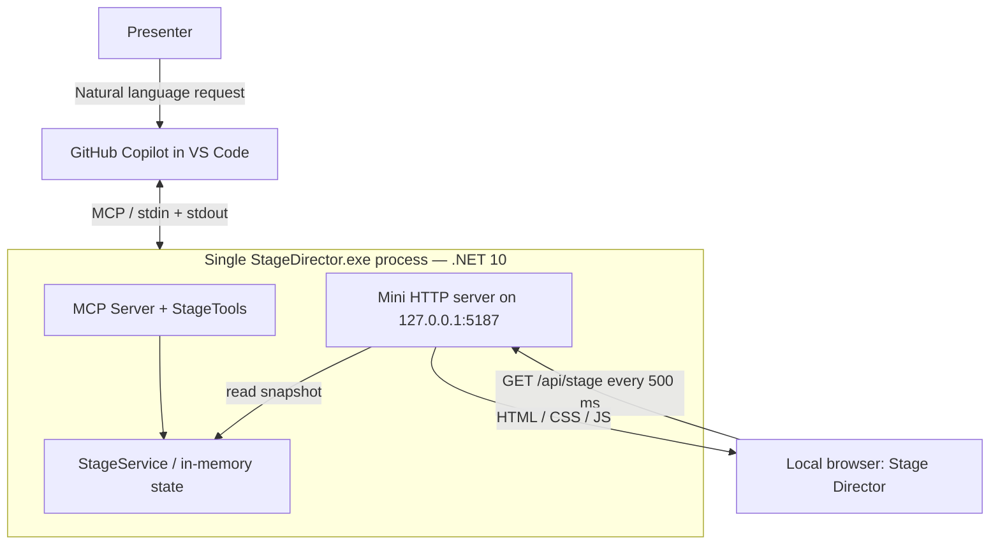

# Demo 03 - Stage Director — Technical and Functional Specification

## 1. Vision and objectives

Functional description: `docs/descriptions/demo03.md`.

Stage Director is a **local, non-destructive Model Context Protocol (MCP) demo**. Through an MCP-compatible client, an AI agent acts as a *virtual stage director* and controls a graphical representation of a stage: scene, simulated lighting, projected message, and animations. The user issues commands in natural language; the model chooses which MCP tools to invoke; the C# code validates the requests, changes the stage state, and makes it visible through a local web page.

The demo must make three educational points clear:

1. **The model decides which capability to request; it does not execute the MCP server's code.**
2. **MCP defines the tool invocation contract; application logic and authorization/validation rules remain in the application.**
3. **A local MCP process can produce a visible effect in the application** without a cloud connection or database.

The demo is intended for a live presentation of approximately **4–5 minutes**. It must be easy to reset and reuse at different conferences.

### 1.1 Measurable objectives

| ID | Objective | Observable outcome |
|---|---|---|
| OBJ-01 | Local MCP interoperability | The client discovers and invokes tools published by a C# process over stdio. |
| OBJ-02 | Real state change | The `activate_scene` call changes the in-memory state, and the browser reflects the change. |
| OBJ-03 | Two core capabilities | `get_stage_status` (read) and `activate_scene` (controlled write) are available. |
| OBJ-04 | Repeatability | `reset_stage` restores the demo to its initial state without deleting external data. |
| OBJ-05 | Ease of execution | A single `.csproj` project and a single process host both the MCP server and local web page. |
| OBJ-06 | Isolation | All operations act exclusively on the simulation; there is no access to devices or user files. |

### 1.2 Out of scope

The following are out of scope: Azure, ASP.NET Core, Azure Functions, databases, OAuth authentication, DMX or IoT controllers, audio, music, cloud deployment, conversation recording, public hosting, loading external plugins, arbitrary filesystem access, and writing files as a tool side effect. Developing a proprietary LLM client is also out of scope; an existing client will be used.

---

## 2. Binding architectural decisions

| Aspect | Specification |
|---|---|
| Language | **C#**, with nullable reference types enabled. |
| Target framework | **.NET 10** (`net10.0`). |
| Packaging | **A single C# Console Application project**, for example `StageDirector.csproj`. No second web project. |
| Application process | A single `StageDirector` process, started by the MCP client through an stdio command. |
| MCP | Official **C# SDK** `ModelContextProtocol`, using the **stdio** transport. |
| Tool discovery | Tool attributes and registration provided by the SDK (e.g. `McpServerToolType`, `McpServerTool`; align the actual APIs with the selected version). |
| Web interface | Static HTML, CSS, and JavaScript **included in the same C# project**. |
| Local HTTP | Minimal HTTP server based on .NET standard library APIs, preferably `System.Net.HttpListener`, without ASP.NET Core or the MCP HTTP transport. |
| Browser endpoint | Default: `http://127.0.0.1:5187/` (configurable port). |
| Storage | Shared state **in memory only**, with no database and no files written at runtime. |
| Recommended client | **GitHub Copilot in Visual Studio Code**, configured with a local stdio MCP server. |
| Reference operating system | Windows 11; the implementation should avoid unnecessary OS dependencies. |
| Network | Only the status page is served on the loopback interface. The MCP protocol is not exposed over HTTP. |

**Note on the “MCP SDK only” constraint:** the official MCP C# SDK must be the only protocol-specific library. .NET APIs and Microsoft hosting/logging libraries needed to bootstrap the SDK are allowed, provided that they **do not introduce a web framework**. Server frameworks such as ASP.NET Core, Azure Functions, SignalR, or equivalents are not allowed.

**Technical note on `HttpListener`:** Microsoft recommends ASP.NET Core for new production HTTP servers. Its use here is deliberately limited to **a read-only localhost demo** to comply with the constraints of one project and no web framework. On Windows, verify that the chosen port is available and that the local prefix does not require additional configuration.

---

## 3. Logical architecture



### 3.1 Distinguishing the two channels

**Channel A — MCP / stdio:** exclusively between GitHub Copilot and the C# process. The client starts the process, communicates over stdin/stdout, discovers tools, and invokes them. The transport does not listen on TCP ports. **stdout is reserved for MCP messages**: it must not be polluted by `Console.WriteLine`, startup banners, exceptions, or logs.

**Channel B — Local HTTP:** exclusively between the browser and the same C# process. It returns static assets and a snapshot of the current state. It **does not** implement MCP, accept commands, or allow scene changes.

**Shared state:** a single `StageService` instance is used by both the MCP tools and the HTTP reader; concurrent access must be thread-safe. The browser does not read or modify memory directly, but receives serialized snapshots through the HTTP API.

### 3.2 Lifecycle

1. The MCP client starts `StageDirector` using `dotnet <absolute-path>/StageDirector.dll` or the published executable.
2. The process initializes the state to `welcome`, starts the local HTTP listener in the background, and enables the MCP server over stdio.
3. The presenter opens `http://127.0.0.1:5187/` in a browser. **The page is available only while the MCP process is running.**
4. Copilot makes one or more MCP calls; polling makes the updates visible in the browser.
5. When the client closes stdin or stops the server, the process exits cleanly and releases the HTTP port. The page is unreachable until the next startup.

The project **must not start a second standalone instance** of the server from the dashboard or terminal during a Copilot session: two concurrent processes would have different state and conflict over the HTTP port.

### 3.3 Startup error handling

If the HTTP port is unavailable, the error must be written to **stderr** without invalidating the MCP stream. The proposed policy is **fail-fast**, with a clear diagnostic message and clean termination: avoid a demo where the tools work but the dashboard appears frozen. The port is configurable before startup (`STAGE_DIRECTOR_PORT`, default `5187`).

---

## 4. Structure of the single project

The solution must contain **a single `.csproj` file** and a single application assembly. The following directories and files are organizational, not separate projects:

```text
MCP-Demos.03-MCPServer/
├── StageDirector.csproj
├── Program.cs
├── README.md
├── .vscode/
│   └── mcp.json                  # example local VS Code configuration
├── Mcp/
│   └── StageTools.cs             # MCP tool exposure and descriptions
├── Domain/
│   ├── StageScene.cs             # scene identifiers
│   ├── StageState.cs             # immutable snapshot
│   └── StageSceneCatalog.cs      # deterministic scene settings
├── Services/
│   └── StageService.cs           # thread-safe application operations
├── Http/
│   └── LocalStageHttpServer.cs   # read-only HTTP, same process
└── Web/
    ├── index.html
    ├── styles.css
    └── stage.js
```

The `Web/*` files belong to **the same project**. For a self-contained deployment, embed the assets as assembly **Embedded Resources** (preferred). Alternatively, they may be copied automatically to the output directory using `.csproj` properties, while still keeping a single project. `npm`, `node`, `vite`, `webpack`, Blazor, and a second web server must not be required.

### 4.1 Responsibilities

| Component | Responsibilities | Prohibitions |
|---|---|---|
| `Program.cs` | MCP SDK bootstrap, shared instances, local listener, shutdown signals. | No tool business logic. |
| `Mcp/StageTools.cs` | Public contracts, metadata, and binding between MCP tools and `StageService`. | Does not access HTML or directly modify global fields. |
| `Domain/*` | Identifiers, immutable state, and configuration for the four scenes. | No dependency on MCP or HTTP. |
| `Services/StageService.cs` | State reading, validation, activation, reset, and synchronization. | No dependency on the AI model. |
| `Http/LocalStageHttpServer.cs` | Serves embedded assets, exposes `GET /api/stage`, and handles HTTP status codes and headers. | **No state-modification API.** |
| `Web/*` | Renders scenes, animations, messages, and connection status. | Cannot call MCP tools directly. |

---

## 5. Domain model

### 5.1 Available scenes

| `scene` | Palette | Example central title | Subtitle | Animation |
|---|---|---|---|---|
| `welcome` | Navy blue and light blue | `WELCOME` | `The show is about to begin` | Slow, subtle spotlights. |
| `focus` | Charcoal and white | `FOCUS MODE` | `Let's dive into the details` | Minimal movement, no distractions. |
| `energy` | Purple, orange, and yellow | `ENERGY MODE` | `Let's wake up the room!` | Dynamic spotlights and moderate pulsing. |
| `celebration` | Green, gold, and vivid colors | `THANK YOU!` | `What a great session!` | Confetti for a limited time. |

Scenes are configured **in code**, with predefined colors and text. The model must not be allowed to send HTML, JavaScript, CSS, file paths, URLs, shell instructions, or arbitrary parameters for the UI to interpret. Transitions should be pleasant but brief (approximately 200–500 ms); motion must respect `prefers-reduced-motion`.

The catalog uses the following concrete theme and effect values:

| Scene | Background | Accent | Intensity | Effect | Effect colors | Duration (ms) |
|---|---|---|---|---|---|---:|
| `welcome` | `#101B39` | `#83BAFF` | `soft` | `ambient` | None | 0 |
| `focus` | `#242424` | `#FFFFFF` | `minimal` | `none` | None | 0 |
| `energy` | `#481D59` | `#FFD34C` | `dynamic` | `pulse` | `#FF8C42` | 0 |
| `celebration` | `#14532D` | `#FFD700` | `festive` | `confetti` | `#FF4D8D`, `#45D9FF`, `#A78BFF` | 4000 |

### 5.2 Current state

An immutable `StageState` value represents a snapshot of the entire scene and includes at least:

| Property | Type | Meaning |
|---|---|---|
| `scene` | string / enum | Canonical identifier for one of the four scenes. |
| `revision` | increasing integer | Incremented for each **effective** state change. |
| `title` | string | Scene's main message. |
| `subtitle` | string | Scene's secondary message. |
| `theme` | object | Catalog-defined `background`, `accent`, `intensity`, and an `effectColors` array (empty when no additional colors are used). |
| `effect` | string | `none`, `ambient`, `pulse`, or `confetti`. |
| `effectDurationMs` | integer | Maximum duration of a temporary effect; `0` for permanent effects. |
| `activatedAtUtc` | ISO 8601 | UTC date/time of the last effective activation. |
| `availableScenes` | string[] | List of valid identifiers. |

The UI uses **`revision`** as an update signal: a new value allows the animation to start only once, preventing polling from replaying the confetti on every request. A command that activates the already-active scene returns `changed: false`, does not increment `revision`, and does not repeat the effect. To replay `celebration`, change scenes or reset and activate it again.

### 5.3 Initial state

At process startup:

- `scene = "welcome"`;
- `revision = 1`;
- colors, messages, and effects match the `welcome` catalog;
- no files are read or modified to restore the previous session.

Losing state when the process exits is **intentional**: it makes the demo easier to repeat.

### 5.4 Concurrency

`StageService` must serialize modifications atomically. A snapshot read during a scene change must be consistent: never `energy` colors with a `focus` title. A `lock` or atomic exchange of immutable objects is acceptable. There is one service instance per process.

---

## 6. Complete MCP tool specification

Public names are stable, use `snake_case`, and the descriptions exposed to the model must be self-explanatory. **Do not assume the model reads the README**: names, parameters, and descriptions are an essential part of the function-calling experience. Tools are invoked through the MCP protocol, not through the web page.

### 6.1 `get_stage_status` tool — required

**Purpose:** read the stage state before or after an action without modifying it.

| Field | Specification |
|---|---|
| MCP name | `get_stage_status` |
| Type | Read-only, with no side effects. |
| Parameters | None: JSON schema `{"type":"object","properties":{},"additionalProperties":false}`. |
| Description shown to the model | “Returns the active scene, its visual effects, and the available scenes on the Stage Director virtual stage. Does not modify state.” |
| Preconditions | Process is running and the service is initialized. |
| Result | Serializable snapshot of `StageState`. |
| Side effects | None. |
| Application errors | Only exceptional internal conditions; no access to external resources. |

**Illustrative example result:**

```json
{
  "scene": "welcome",
  "revision": 1,
  "title": "WELCOME",
  "subtitle": "The show is about to begin",
  "theme": { "background": "#101B39", "accent": "#83BAFF", "intensity": "soft", "effectColors": [] },
  "effect": "ambient",
  "effectDurationMs": 0,
  "activatedAtUtc": "2026-11-17T09:00:00Z",
  "availableScenes": ["welcome", "focus", "energy", "celebration"]
}
```

The timestamp is illustrative only. At runtime, it must correspond to the actual process timestamp.

### 6.2 `activate_scene` tool — required

**Purpose:** change the virtual scene by selecting a known preset.

| Field | Specification |
|---|---|
| MCP name | `activate_scene` |
| Type | Controlled state modification. |
| Parameter | `scene` (string, required). |
| Allowed values | `welcome`, `focus`, `energy`, `celebration`. |
| Input schema | JSON object with a required `scene` property and an `enum` of the four values; additional properties are not allowed. |
| Description shown to the model | “Activates a predefined scene on the Stage Director virtual stage. Choose one of: welcome, focus, energy, celebration. The call changes local graphical effects only; it does not control lights or physical devices.” |
| Preconditions | `scene` is valid; service is available. |
| Logic | Validates the value, retrieves the preset, atomically creates a new `StageState`, and increments `revision` only if the scene changes. |
| Postcondition | `get_stage_status` and `/api/stage` return the same snapshot. |
| Side effects | Process memory and the representation in the browser only. |

**MCP input example:**

```json
{ "scene": "energy" }
```

**Example application result:**

```json
{
  "success": true,
  "changed": true,
  "previousScene": "welcome",
  "currentScene": "energy",
  "revision": 2,
  "stage": {
    "scene": "energy",
    "revision": 2,
    "title": "ENERGY MODE",
    "subtitle": "Let's wake up the room!",
    "theme": { "background": "#481D59", "accent": "#FFD34C", "intensity": "dynamic", "effectColors": ["#FF8C42"] },
    "effect": "pulse",
    "effectDurationMs": 0,
    "activatedAtUtc": "2026-11-17T09:01:00Z",
    "availableScenes": ["welcome", "focus", "energy", "celebration"]
  }
}
```

**Invalid input:** `activate_scene({"scene":"laser_show"})` must not modify state. The tool must return an understandable validation error, for example `INVALID_SCENE` with a list of allowed values, using the SDK's error mechanism for tool calls; do not represent failed validation as successful execution. Error details must not contain stack traces or host data.

**Idempotency:** calling `activate_scene` with the already-active scene returns `success: true`, `changed: false`, with `revision` unchanged.

### 6.3 `reset_stage` tool — recommended for the demo

**Purpose:** restore the initial scene safely and repeatably.

| Field | Specification |
|---|---|
| MCP name | `reset_stage` |
| Parameters | None. |
| Description shown to the model | “Resets the virtual stage to the welcome scene. Acts on in-memory state only; does not delete files or modify devices.” |
| Result | `success`, `changed`, `previousScene`, `currentScene`, `revision`, `stage`. |
| Effects | Sets `welcome`; changes `revision` only if the previous value was different. |
| Idempotency | Two consecutive resets produce a second result with `changed: false`. |

`reset_stage` is **recommended as a third tool** for the presenter. If **exactly two tools** are to be shown, the reset function may remain available **only as an administrative command at application startup**, without appearing in MCP. This specification prefers **three tools**, because that makes live operation easier without restarting the client.

### 6.4 Common tool rules

- MCP parameters must be validated **on the server side**, even if the schema constrains model inputs.
- Descriptions must avoid ambiguity and include the canonical scene identifiers.
- No tool may launch processes, read arbitrary files, invoke PowerShell, or send network requests.
- Access to the tool list must not depend on previous calls; the catalog remains stable throughout execution.
- Outputs must be JSON-friendly and minimal; expected errors must be handled without terminating the process.
- Do not add generic tools such as `run_command`, `execute_script`, `write_file`, or `open_url`.

---

## 7. Local mini HTTP server specification

### 7.1 Allowed APIs

| Method | Path | Response | Function |
|---|---|---|---|
| `GET` | `/` | `200 text/html` | Stage Director page. |
| `GET` | `/styles.css` | `200 text/css` | Embedded stylesheet. |
| `GET` | `/stage.js` | `200 text/javascript` | Embedded display script. |
| `GET` | `/api/stage` | `200 application/json` | **Read-only** state snapshot. |
| Any other method/URL | Other paths | `404` or `405` | No access or execution. |

The `GET /api/stage` endpoint returns **the same DTO as `get_stage_status`**, although they are two distinct interfaces. `POST`, `PUT`, `DELETE`, queries to manipulate state, directory listing, and arbitrary file serving are not allowed.

### 7.2 HTTP restrictions

- Listen **only on loopback** (`127.0.0.1`), never on `0.0.0.0`, `+`, `*`, or LAN addresses.
- Default `5187`, configurable through the `STAGE_DIRECTOR_PORT` environment variable (port 1024–65535).
- No open CORS; assets and API use the same origin.
- `Cache-Control: no-store` at least for `/api/stage`.
- `X-Content-Type-Options: nosniff` and a CSP compatible with local assets, with no inline scripts or CDN.
- Every HTTP request must have a timeout and exception handling: a disconnected browser must not bring down the MCP server.
- No personal data or tokens in the API.

### 7.3 Behavior when disconnected

If the process is closed, the dashboard must show *“Stage Director unreachable”* through a visual indicator, rather than continuing to display state as if it were current. Aggressive retries are unnecessary: the UI may continue attempting a read every 1–2 seconds until the server becomes available again.

---

## 8. Web dashboard specification

### 8.1 Layout

A single responsive page, designed primarily for **16:9 projection** and legible from a distance. It must have:

1. A generic `STAGE DIRECTOR` heading, with no logos or references to a specific event.
2. A main area representing a virtual stage (backdrop, central screen, light beams, and stylized floor).
3. The current scene's main message and subtitle in very large type.
4. A subtle indicator for the active scene and connection status.
5. Exclusively local, non-destructive graphical effects.

The UI must not contain buttons for changing scenes: the demonstration's value is that the change happens **through an MCP tool**. A page refresh button is allowed, as it does not modify state. Avoid administrative dashboards, complex charts, modals, or production control room interfaces.

### 8.2 Synchronization

The `stage.js` script performs `GET /api/stage` every **500 ms** using `fetch` and `cache: 'no-store'`. It compares the `revision` field with the one already rendered and updates the DOM only when it changes. It must never overlap two requests while the previous one is still in progress (e.g. by using a flag or `AbortController`).

### 8.3 Visual effects

- **Welcome:** slow blue beams with soft shadows.
- **Focus:** nearly static animations and subdued tones.
- **Energy:** moderate pulsing and brightness changes, with no rapid strobing.
- **Celebration:** confetti for about **4 seconds** when a new `revision` arrives, then return to a static celebratory backdrop.
- **Accessibility:** support `prefers-reduced-motion`; color and text must communicate state even without animations.
- **No audio:** no dependency on autoplay or the presenter's sound system.

### 8.4 Error state

If the API is unreachable or returns invalid JSON: show the `DISCONNECTED` indicator, keep the last scene **marked as stale**, do not reactivate effects, and do not throw unhandled JavaScript exceptions. When the connection is restored, synchronize the snapshot.

---

## 9. MCP client: GitHub Copilot in VS Code

### 9.1 Client selection

**Reference client:** VS Code with GitHub Copilot, because it allows registering and starting a local server over stdio. Direct use of ChatGPT is not a dependency of this specification and must not block the demo.

The protocol remains interoperable: another MCP client that supports stdio could be substituted without changing the Stage Director logic.

### 9.2 Reference configuration

For a **local VS Code** configuration, an illustrative form is:

```json
{
  "servers": {
    "stage-director": {
      "type": "stdio",
      "command": "dotnet",
      "args": [
        "C:/absolute/path/StageDirector/bin/Release/net10.0/StageDirector.dll"
      ]
    }
  }
}
```

This example can be placed in `.vscode/mcp.json` **for the local VS Code workflow that supports this format**. Some recent Copilot versions instead favor portable configurations with the `mcpServers` key in a global or workspace file: **do not mix** the two schemas. The plan generated from this specification must select the format actually supported by the demo installation, using up-to-date documentation. For a stage demo, an absolute path to **already built/published** output is preferred; avoid `dotnet run` during stdio calls to reduce startup time and unexpected output.

### 9.3 User experience

The presenter should be able to ask, for example:

- “Check the current Stage Director status.”
- “We're starting a technical session: create a subdued, focused atmosphere.”
- “The audience is getting bored: make the stage more energetic.”
- “It's time to say goodbye: set up a final celebration.”
- “Return the stage to its initial scene.”

The model must choose `get_stage_status`, `activate_scene`, and, where available, `reset_stage`. The selection may vary by model; the server must not assume a fixed sequence of calls.

### 9.4 Availability and process boundaries

The client **is responsible for starting and terminating** the stdio process. The HTTP listener is created inside that process: **start the MCP connection first, then open the web page**. If the client starts multiple instances, select only one active instance; do not share state between processes. Diagnostic logs go to stderr or an explicitly configured log, never to stdout.

---

## 10. Security, robustness, and development principles

### 10.1 Limiting the attack surface

- Expose functions only for enumerated scenes and synthetic state.
- No shell, file-writing, outbound HTTP, deletion, or hardware-access capabilities.
- The browser has no mutable endpoints and does not acquire the model's privileges.
- Local HTTP service with a fixed-path allowlist.
- No dependency on CDNs or remote JavaScript packages.
- Any `scene` input is validated and mapped to **hard-coded configurations**; never use `innerHTML` with untrusted input.
- Do not use `Console.WriteLine` or any other non-MCP output on stdout.

### 10.2 C#/.NET best practices

- Enable `Nullable` and `ImplicitUsings`, .NET analyzers, and meaningful warnings.
- Prefer small classes with distinct responsibilities; `StageTools` remains a thin adapter to `StageService`.
- Expose immutable DTOs and consistently serialized responses (`System.Text.Json`).
- Control concurrency boundaries with atomic state and thread-safe code.
- Propagate `CancellationToken` to the HTTP listener and shutdown where supported.
- Handle exceptions in one central location; provide understandable client errors and write technical details only to stderr.
- Shut down both channels cleanly on EOF/stdin closure and shutdown signals.
- Minimize NuGet dependencies; explicitly pin the MCP SDK version in the project.
- Avoid dynamic reflection of untrusted classes, plugin loaders, and execution of model-generated code.

### 10.3 MCP specification compatibility

The reference target is the MCP specification published **2026-07-28**; clients and SDKs may support earlier versions. Verify stdio mode and actual compatibility against the installed versions, relying on the SDK for handshake/protocol metadata and JSON-RPC serialization rather than implementing them manually. In the 2026-07-28 revision, request metadata is per-request; the previous protocol had `initialize`. The demo must avoid any application-level assumptions tied to a remote MCP session.

---

## 11. Error behavior and edge cases

| Situation | Required behavior |
|---|---|
| Unexpected scene value | Well-formed MCP tool error; state remains unchanged. |
| Scene already active | Successful response with `changed: false`; revision unchanged. |
| Two `activate_scene` requests in quick succession | Consistent final state and monotonically increasing revisions. |
| Browser closed | Tools continue to work; no crash. |
| Browser opened before MCP startup | Connection error visible in the browser; no second process is created. |
| MCP process terminated | HTTP listener stops and the port is released. |
| Port 5187 occupied | Explicit error on stderr; no silent partial startup. |
| Embedded HTML/CSS/JS file missing | Locally diagnosable error; no access to arbitrary directories. |
| HTTP request with unsupported method | Appropriate `405 Method Not Allowed` or `404`. |
| `celebration` repeated without a scene change | Confetti does not automatically restart. |
| No Internet connection | MCP server and dashboard remain executable; the Copilot model may require Internet access. |

---

## 12. Solution acceptance criteria

These conditions describe **how to verify the product**, not an implementation sequence:

| ID | Verifiable criterion |
|---|---|
| AC-01 | Repository has a single `net10.0` `.csproj`, with no ASP.NET/Functions projects or separate web processes. |
| AC-02 | An stdio MCP client sees and invokes `get_stage_status` and `activate_scene` using their exact names. |
| AC-03 | With the MCP process running, `http://127.0.0.1:5187/` displays the stage. |
| AC-04 | The `activate_scene({"scene":"focus"})` call changes the UI without a manual reload. |
| AC-05 | The state read through MCP matches the state from `GET /api/stage`. |
| AC-06 | An invalid scene input is rejected and leaves the state unchanged. |
| AC-07 | A reset returns the `welcome` scene and does not change `revision` if the state is already initial. |
| AC-08 | No call introduces log output on stdout. |
| AC-09 | `celebration` produces confetti only once per revision, for a limited duration. |
| AC-10 | All visual effects use local assets included in the same project. |
| AC-11 | Closing the MCP process also stops the HTTP listener. |
| AC-12 | The demo works without administrator permissions in a correctly configured Windows development environment. |
| AC-13 | No HTTP API can write or modify state. |
| AC-14 | The dashboard has a clear indicator that it is disconnected from the local process. |
| AC-15 | The Stage Director name and graphics are reusable without fixed references to WPC. |

---

## 13. Demo scenarios (narrative requirements, not a plan)

To verify that the product is effective in a live setting, support at least three natural-language narratives:

| Scenario | Example request | Expected tools | On-screen result |
|---|---|---|---|
| Opening | “We're starting a technical talk. We need fewer distractions.” | `get_stage_status`, `activate_scene(focus)` | Dark stage, `FOCUS MODE` title. |
| Change of pace | “The audience needs some energy!” | `activate_scene(energy)` | Purple/orange colors and more dynamic lights. |
| Finale | “We're done. Let's have a grand finale!” | `activate_scene(celebration)` | Thank-you screen and confetti. |

The product must not depend on executing all three scenarios exactly or on a specific call order: each tool must work independently. The message to communicate to the audience is: **“The AI chooses the tool; the C# process performs the action; the browser shows its effect.”**

---

## 14. Constraints to pass to the next plan generator

This document is **the contractual input** for any future implementation plan. The future plan must respect the following invariants without changing them implicitly:

- **A single C# Console project on .NET 10.**
- **Official MCP SDK and stdio transport.**
- **No ASP.NET Core, Azure Functions, cloud, database, or runtime dependency on Node.js.**
- **A single process** hosting both MCP and the localhost HTTP server.
- **Two required functional tools** (`get_stage_status`, `activate_scene`); **a third reset tool is recommended**.
- **Four finite scenes** (`welcome`, `focus`, `energy`, `celebration`), with no arbitrary commands.
- **Static, read-only local web page**; no mutable endpoints.
- **HTML/CSS/JS assets in the same project**, preferably embedded.
- **No destructive operations, modifications to user files, or hardware access.**
- **Reference client: VS Code + GitHub Copilot**, configured as a local stdio MCP server.
- **Repeatability and reliability on stage** take priority over technological complexity.

This specification does **not** prescribe implementation phases, development priorities, estimates, assignments, milestones, or a backlog.

---

## 15. Official technical references

Recheck these references when generating the plan, because the SDK and client configurations may evolve:

1. [MCP C# SDK — official repository](https://github.com/modelcontextprotocol/csharp-sdk)
2. [MCP C# SDK — Getting Started](https://csharp.sdk.modelcontextprotocol.io/concepts/getting-started.html)
3. [MCP — 2026-07-28 specification](https://modelcontextprotocol.io/specification/2026-07-28)
4. [MCP — stdio transport (specification)](https://github.com/modelcontextprotocol/modelcontextprotocol/blob/main/docs/specification/2026-07-28/basic/transports/stdio.mdx)
5. [VS Code — Add MCP servers](https://code.visualstudio.com/docs/agent-customization/mcp-servers)
6. [VS Code — MCP configuration reference](https://code.visualstudio.com/docs/agents/reference/mcp-configuration)
7. [.NET — System.Net.HttpListener](https://learn.microsoft.com/en-us/dotnet/api/system.net.httplistener?view=net-10.0)
