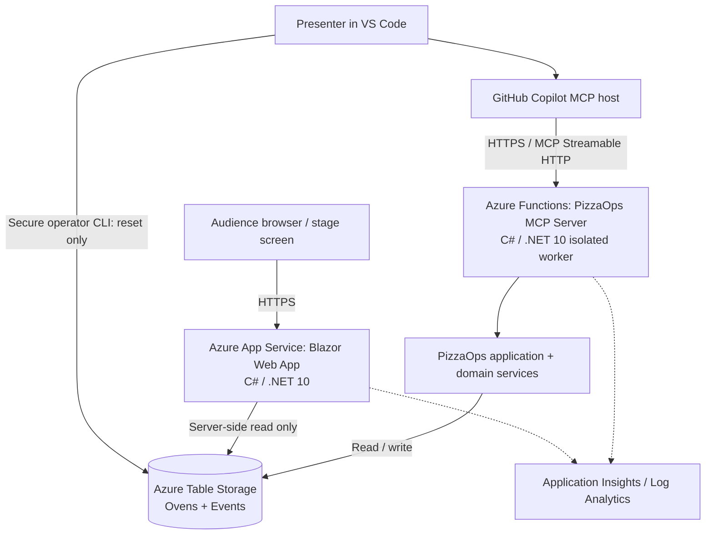
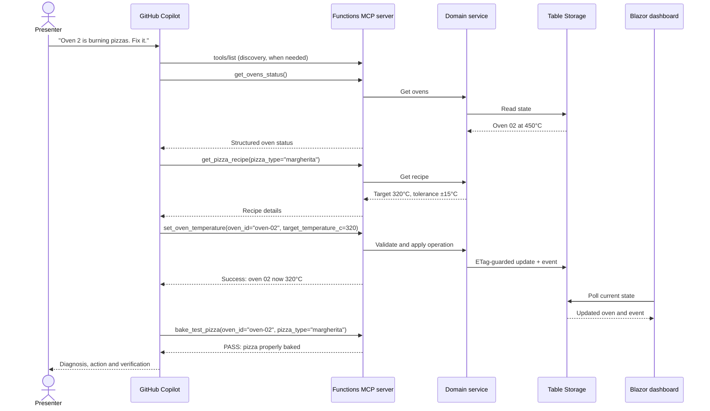

# DEMO 03 - PizzaOps — MCP-Powered Cloud Pizzeria

## 1. Executive summary

Build **PizzaOps**, a small, humorous, cloud-hosted demonstration of the Model Context Protocol (MCP). A presenter uses **GitHub Copilot in Visual Studio Code** as the MCP host/client to diagnose and repair a malfunctioning pizza oven. An **MCP server written in C# on .NET 10, deployed to Azure Functions**, exposes a small, discoverable set of domain-oriented tools. An independent **Blazor dashboard on Azure App Service** shows the effects of tool calls almost immediately. Both applications use the same state stored in **Azure Table Storage**.

The demo is designed for **approximately 10 minutes on stage** and prioritizes reliability, legibility, minimal cost, and clear technical lessons over realism or feature count.

**Narrative:** Oven 02 is at **450°C**, far outside the simulated operating range. Copilot reads the oven status, retrieves the appropriate pizza recipe, adjusts the oven, and runs a deterministic test bake. The dashboard changes from **CRITICAL** to **HEALTHY**. The presenter then tries to set an oven to **600°C**; the server refuses, proving that the LLM's ability to request a tool is not authority to bypass server-side safety rules.

> **Core message:** GitHub Copilot decides *which* action to request; MCP defines *how* the capability is exposed and called; C# business logic decides *whether* the action is permitted.

### 1.1 Goals

1. Demonstrate a **real, remotely accessible MCP server**, not a mocked JSON-RPC transcript.
2. Keep all solution code in **C# / .NET 10** (including the web UI, Functions application, domain services, tooling, and tests).
3. Run the MCP server in **Azure Functions .NET isolated worker** using the official Azure Functions MCP extension.
4. Run a visually appealing **Blazor Web App** on Azure App Service.
5. Show a shared and persistent state without introducing an unnecessary database or event infrastructure.
6. Make the audience see read, decision, write, and verification steps through Copilot tool invocations and dashboard changes.
7. Show one deliberately blocked operation with explicit server-side validation and an auditable event.
8. Support deterministic reset, local development, automated testing, and reproducible Azure deployment.
9. Keep the domain services independent from MCP bindings so they are unit-testable and could also be exposed through a conventional REST API.

### 1.2 Non-goals for the initial demo

- No real ovens, IoT devices, temperature sensors, or payments.
- No ordering, stock, kitchen staff, customers, or restaurant workflow engine.
- No LLM inference inside the Azure applications: **Copilot is the only agent**.
- No Cosmos DB, Azure SignalR, Event Grid, Service Bus, Kubernetes, API Management, or Azure AI model resources for the MVP.
- No complex physics simulation or asynchronous cooking cycle. A test bake is immediate and deterministic.
- No editable dashboard or public admin UI.
- No attempt to demonstrate OAuth end-to-end in the 10-minute main demo. It may be a later enhancement.
- No guarantee that Copilot will call tools in a particular order; the demo should tolerate alternative valid plans.

---

## 2. Reference architecture

### 2.1 Logical architecture



### 2.2 Separation of concerns

| Component | Responsibilities | Explicitly must not do |
|---|---|---|
| **GitHub Copilot** | Interpret presenter prompt; discover tools; choose tool arguments; request MCP tool calls; interpret results | Access Azure Table Storage directly, bypass the tool policies, or determine authorization for the server |
| **Functions MCP adapter** | Publish MCP tool catalog and schemas; deserialize requests; map results; enforce request-level security; invoke application services | Contain recipe math, persistence queries, or a duplicated domain model |
| **Application/domain layer** | Safety validation, oven status, recipe lookup, state transitions, deterministic test bake, domain outcomes | Depend on Copilot, Blazor, Azure Functions attributes, or transport-specific objects |
| **Table Storage adapter** | Load/update entities with ETag concurrency checks, append small event records | Decide what oven temperature is safe |
| **Blazor dashboard** | Display oven cards, event feed, status indicators, explain tool effects | Modify oven state, expose storage credentials to the browser, call MCP tools, or offer a public reset |
| **Operator reset utility** | Prepare the demo's known initial state | Be discoverable as an MCP tool or accessible anonymously |

### 2.3 Request flow



**Important:** `tools/list` and `tools/call` are MCP protocol operations; the four PizzaOps tool names below are domain capabilities within those operations. The dashboard's HTTP JSON endpoint is **not** an MCP endpoint. Both interfaces can share the same domain logic.

### 2.4 MCP transport and compatibility

- Public MCP URL pattern: `https://<function-app>.azurewebsites.net/runtime/webhooks/mcp` (verify the final route against the deployed extension configuration).
- Transport: **Streamable HTTP over HTTPS**. No `stdio` server is required for the Azure deployment.
- Protocol target: **MCP 2026-07-28**, with the implementation's actual negotiated version verified during an integration test.
- In MCP 2026-07-28, the core protocol is **stateless per request**; the persistent *oven state* lives in Table Storage, not an MCP transport session.
- Do not manually implement JSON-RPC, stream framing, server discovery, or `initialize` in application code. Use the supported Azure Functions MCP extension. There may be a protocol-version gap between the extension and a particular Copilot release; **test interoperability before the presentation**, and pin compatible versions. The application must not assume that every SDK/host has migrated to the latest specification.
- Tool definitions must be stable and deterministic across calls. User-visible instructions cannot be trusted as authorization controls.

---

## 3. Azure resources and deployment topology

### 3.1 Required resources (MVP)

| Azure resource | Suggested name pattern | Purpose / configuration |
|---|---|---|
| Resource group | `rg-mcp-demos-<environment>` | Same Resource Group used by the demo 02 |
| App Service plan | `asp-pizzaops-<env>` | Linux plan capable of running ASP.NET Core / .NET 10; size for one interactive demo audience |
| Web App | `app-pizzaops-dashboard-<env>` | Hosts Blazor Web App; HTTPS only; managed identity; .NET 10 runtime |
| Function App | `func-pizzaops-mcp-<env>` | Azure Functions v4, **.NET 10 isolated worker**, HTTPS MCP endpoint, managed identity |
| Functions hosting plan | `plan-pizzaops-functions-<env>` | **Flex Consumption** on Linux for .NET 10; configure an always-ready instance if supported and justified for on-stage latency; alternative Premium if needed |
| Storage account | `stpizzaops<unique>` | Azure Functions host storage plus two Azure Table Storage tables (MVP cost optimization); private data access by Azure RBAC where supported |
| Table: ovens | `PizzaOpsOvens` | Shared current simulated oven state |
| Table: events | `PizzaOpsEvents` | Small chronological event/audit feed |
| Application Insights | `appi-pizzaops-<env>` | Telemetry for requests, errors, exceptions, and traces |
| Log Analytics workspace | `log-pizzaops-<env>` | Backing workspace for telemetry and troubleshooting |

**Deployment prerequisites:** Azure subscription; supported region; globally unique resource names; .NET 10 SDK; Azure Functions Core Tools; Azure CLI; Azure Developer CLI (`azd`) if used; and permission to assign managed identity/RBAC roles. Use the existing bicep files and extend them with the new resources. AZD Provision command should deploy everything.

**Hosting note:** .NET 10 with Azure Functions on Linux is not supported by the *classic Consumption plan*. Use **Flex Consumption**. App Service supports .NET 10 as an application runtime. Check the selected region, runtime stack, MCP extension version, and service-plan feature availability when producing IaC.

### 3.2 Identity and permissions

| Identity | Access |
|---|---|
| Function App system-assigned managed identity | **Storage Table Data Contributor** on the application storage scope (prefer narrower scope where available), plus any host-storage permissions required by the chosen Functions identity-based configuration |
| Web App system-assigned managed identity | **Storage Table Data Reader** on the application storage scope; no write permissions |
| Deployment identity | Least-privilege Azure permissions required to deploy infrastructure/code and assign roles |
| Presenter / operator identity | Explicitly authorized to run the reset utility; no storage account keys in source control |
| Copilot's remote MCP access | Initially via the Functions MCP endpoint's access key, stored as a local secret; may be upgraded to Microsoft Entra ID before production reuse |

**Security distinction:** A Functions access key is a **shared secret**, not proof of the identity of the person operating Copilot. Therefore the MVP's 600°C rejection is a **domain safety policy**, not a demonstration of per-user authorization. A true authorization demo needs validated caller identity and policy claims (for example, Entra ID).

### 3.3 Recommended, optional resources

- **Azure Key Vault:** recommended if central secret management is needed; for this small MVP, environment-local secure storage for the MCP key may be enough. Never commit keys.
- **Custom domain / TLS certificate:** optional; `azurewebsites.net` HTTPS is adequate.
- **Azure Monitor alerts:** optional for the presentation, useful for subsequent production-quality development.
- **Application Gateway / API Management:** deliberately excluded from MVP; add only for a later enterprise gateway demonstration.
- **Azure SignalR Service:** excluded. A 1-second browser poll is adequate and much simpler to debug.

### 3.4 Infrastructure as Code

Use **Bicep** as the source of truth. Use the Bicep structure already exist for the other demos managed by **Azure Developer CLI (`azd`)**. The infrastructure definition should:

1. Create the listed resources with deterministic environment-based naming.
2. Configure `.NET 10` app runtime and the isolated Functions runtime correctly.
3. Enable system-assigned managed identities for both compute resources.
4. Configure HTTPS-only, minimum TLS settings, and appropriate cross-origin restrictions.
5. Assign Table Storage data-plane roles to identities.
6. Configure Application Insights connection settings.
7. Set application settings (table names, storage account endpoints, polling defaults, application environment and feature flags) without checking in credentials.
8. Provision the tables during deployment/initialization in a controlled manner.
9. Export dashboard URL and MCP endpoint URL as deployment outputs (**not** the access key).
10. Support `dev` and `demo` environment parameter files; avoid unreproducible portal-only changes.

For the demo, **one resource group and one storage account** are acceptable. If the solution grows, split Functions host storage from application data storage to improve isolation and permission scoping.

Add the resources of this demo to the resources already used for the other demos. Use tag to identify resopurce for this demo.

---

## 4. Technology stack and solution structure

### 4.1 Baseline

- **Language:** C# 14 (or latest stable language features included with .NET 10).
- **Target framework:** `net10.0` for all application/library/test projects.
- **Web framework:** ASP.NET Core 10 **Blazor Web App**, using interactive server rendering for the dashboard UI where interactive behavior is needed.
- **Functions worker:** Azure Functions v4, **.NET isolated worker** (`dotnet-isolated`).
- **MCP integration:** `Microsoft.Azure.Functions.Worker.Extensions.Mcp`; check extension release, generated tool schemas, and supported protocol revision before pinning the final version.
- **Persistence:** `Azure.Data.Tables` and `Azure.Identity` using dependency injection.
- **Logging/monitoring:** `ILogger<T>`, OpenTelemetry-compatible correlation where supported, Application Insights.
- **Testing:** No tests for the first version of the demo.
- **Quality tooling:** .NET analyzers, nullable reference types, `.editorconfig`, formatting checks, Central Package Management, dependency auditing.
- **Deployment:** Bicep, GitHub Actions, optionally `azd`; OpenID Connect / workload identity federation for deployment.

### 4.2 Suggested repository layout

```text
src/
├──MCP-Demos03-PizzaOps
│  ├── README.md
│  ├── PizzaOps.Core/                 # Core Classes and structures
|  |   ├── Domain                     # Oven rules, recipes, result types
│  |   ├── Application/               # Services and interfaces
│  |   ├── Contracts/                 # Read-only DTOs shared across apps
│  ├── PizzaOps.Storage/              # Azure Table Storage adapters
│  ├── PizzaOps.Functions/            # MCP-trigger Functions + host.json
│  ├── PizzaOps.Dashboard/        # Blazor dashboard + read-only API
│  └── PizzaOps.DemoAdmin/            # Authorized seed/reset console CLI
```

Bidep files should be in the infra exixting directory under the root

### 4.3 Dependency direction

```text
PizzaOps.Core
       ↑
PizzaOps.Storage (implements application interfaces)
       ↑
PizzaOps.Functions     PizzaOps.Dashboard     PizzaOps.DemoAdmin
          (composition roots, each references the required layers, they can refer also to Core)
```

Keep project references acyclic. The Core project should not reference any Azure SDK types or MCP trigger attributes. Register interfaces using dependency injection in each executable host.

### 4.4 Principal C# abstractions

These names are **proposed design interfaces**, not claims about existing SDK APIs.

```csharp
public interface IOvenRepository
{
    Task<IReadOnlyList<Oven>> GetAllAsync(CancellationToken ct);
    Task<Oven?> GetByIdAsync(string ovenId, CancellationToken ct);
    Task<UpdateOvenResult> TrySetTemperatureAsync(
        string ovenId, int targetTemperatureC, string reason, CancellationToken ct);
}

public interface IRecipeCatalog
{
    Recipe? FindByType(string pizzaType);
}

public interface IKitchenEventRepository
{
    Task AppendAsync(KitchenEvent @event, CancellationToken ct);
    Task<IReadOnlyList<KitchenEvent>> GetLatestAsync(int count, CancellationToken ct);
}

public interface IKitchenService
{
    Task<KitchenSnapshot> GetStatusAsync(CancellationToken ct);
    RecipeResult GetRecipe(string pizzaType);
    Task<SetTemperatureResult> SetTemperatureAsync(
        string ovenId, int targetTemperatureC, string? reason, CancellationToken ct);
    Task<TestBakeResult> BakeTestPizzaAsync(
        string ovenId, string pizzaType, CancellationToken ct);
}
```

`IOvenRepository` must support optimistic concurrency; the interface can be refined to expose version tokens/ETags. The domain/application layer must decide safety before persistence, and the storage layer must re-check the concurrency token during the update. Avoid writing generic CRUD repositories for a four-tool demo if they obscure intent.

---

## 5. Domain and deterministic simulation

### 5.1 Initial state

| Oven ID | Label | Initial temperature | Initial health | Comment |
|---|---|---:|---|---|
| `oven-01` | Oven 01 | 320°C | HEALTHY | Ideal for Margherita |
| `oven-02` | Oven 02 | **450°C** | **CRITICAL** | Deliberate demo incident: pizzas are burned |
| `oven-03` | Oven 03 | 300°C | HEALTHY | Available but not affected |

### 5.2 Simulated operating rules

- **Allowed commanded temperature:** integer **200–350°C inclusive**.
- A recorded oven above 350°C (such as the initial malfunction) is **CRITICAL**; the policy still permits setting it *down* into the allowed range.
- An oven within 200–350°C is **HEALTHY** for this simplified demo. A healthy oven is not necessarily correctly configured for every recipe.
- The 600°C command must be rejected as `TEMPERATURE_OUT_OF_RANGE` **without altering oven state**.
- If an oven ID is unknown, return `OVEN_NOT_FOUND`; never silently create an oven from a tool call.
- The target for a successful Margherita test bake is **320°C**, with a tolerance of **±15°C** (inclusive).
- Baking is immediate: it reads current temperature and returns `PASS`, `UNDERCOOKED`, or `BURNT`; it does not wait or run a background job.
- No hidden timers, randomized measurements, ambient drift, or real-world heating/cooling behavior.
- All rules belong to a single source of truth in the domain/application layer; the dashboard only *displays* backend-computed statuses.

### 5.3 Recipe catalog

| `pizza_type` | Display name | Target temperature | Accepted range for `PASS` |
|---|---|---:|---:|
| `margherita` | Margherita | 320°C | 305–335°C |
| `marinara` | Marinara | 300°C | 285–315°C |
| `diavola` | Diavola | 310°C | 295–325°C |

The names/temperatures are **game mechanics**, not culinary guidance. Keep recipe values centralized, immutable at runtime, and visible in tool results.

### 5.4 State model

```text
Oven
  OvenId: string                  # Stable identifier, e.g. "oven-02"
  DisplayName: string             # "Oven 02"
  TemperatureC: int               # Current simulated temperature
  Health: enum                    # Derived: HEALTHY | CRITICAL
  UpdatedAtUtc: DateTimeOffset
  LastAction: string?             # Short descriptive text
  Version: string                 # ETag/version returned by persistence layer

Recipe
  PizzaType: string
  DisplayName: string
  TargetTemperatureC: int
  ToleranceC: int

KitchenEvent
  EventId: string
  TimestampUtc: DateTimeOffset
  EventType: string               # TEMPERATURE_CHANGED, TEMPERATURE_REJECTED, TEST_BAKE, RESET
  OvenId: string?
  Summary: string                 # Safe, short text for public UI
  Outcome: string                 # SUCCESS | REJECTED | PASS | FAIL
  CorrelationId: string?

KitchenSnapshot
  RetrievedAtUtc: DateTimeOffset
  Ovens: OvenStatusDto[]
  RecentEvents: KitchenEventDto[]
```

### 5.5 Table Storage entity design

**Table `PizzaOpsOvens`:**

- `PartitionKey`: environment-specific demo key, for example `main-kitchen`.
- `RowKey`: oven ID (`oven-01`, `oven-02`, `oven-03`).
- Properties: `DisplayName`, `TemperatureC`, `UpdatedAtUtc`, `LastAction`; Table Storage ETag is used for optimistic concurrency.
- Do not persist derived `Health` if it can be calculated consistently from `TemperatureC`.

**Table `PizzaOpsEvents`:**

- `PartitionKey`: `main-kitchen` (or an environment/demo-run identifier).
- `RowKey`: sortable UTC timestamp prefix plus collision-resistant suffix (for example a GUID); avoid key collisions.
- Properties: event type, oven ID, outcome, safe summary, UTC timestamp, correlation ID.
- Only return the latest **20** event records to the dashboard; enforce sensible retention or cleanup as a maintenance task.
- Event append occurs after a successful state mutation. Because the oven and event tables are separate, the operations are not atomic across tables: the event feed is **best-effort operational telemetry**, not an immutable financial-grade audit ledger. Log append failures and consider an outbox if stronger guarantees are later required.

### 5.6 Concurrency and repeatability

- Use `ETag` / `If-Match` semantics when changing oven state; reject or retry a concurrent update in a bounded, observable way.
- Setting an oven to its current temperature must be safe; optionally return `NO_CHANGE` and avoid a duplicate event.
- Ensure rejected commands never write an oven state.
- The seed/reset operation replaces data with known values and clears or tags previous events for a fresh run.
- No critical business state is kept in static in-memory fields or local files in Functions or App Service.

---

## 6. MCP server: detailed tool contracts

### 6.1 General design conventions

- Publish **exactly four MVP tools** with simple, descriptive snake_case names.
- Tool descriptions should be written **for the model**: state when to use them, what they return, and the difference between read and mutation.
- Prefer small JSON argument schemas; mark every required parameter explicitly.
- All tool handlers call `IKitchenService`; no Azure Table queries in Functions methods.
- Return compact, predictable structured JSON data (or JSON-serialized content when dictated by the extension's supported response mapping). Verify the actual wire format using MCP Inspector and Copilot.
- Include `success`, `code`, `message`, and relevant `data`; for business-rule failures use a domain result rather than pretending an HTTP 200 is a successful temperature update.
- Unexpected server faults must be logged and surfaced as a safe generic failure; do not leak stack traces, secrets, storage endpoints, or raw exception objects to the model.
- All timestamps in UTC ISO 8601 and temperatures in integer °C.
- Tool descriptions are **not a security boundary**. Validate authorization and every argument inside server code regardless of how the model was prompted.

#### Shared conceptual response envelope

```json
{
  "success": true,
  "code": "OK",
  "message": "Human-readable outcome",
  "data": {},
  "correlation_id": "trace-or-operation-id"
}
```

This is **application-level JSON content** returned from MCP tools, not a replacement for the MCP JSON-RPC response envelope. The binding/SDK owns protocol serialization.

### 6.2 Tool 1 — `get_ovens_status`

**Purpose:** Discover the current operational state of all ovens; identify a dangerous temperature and obtain stable oven IDs for follow-up calls.

**Model-facing description (suggested):**

> Returns the current temperatures and health status of all PizzaOps ovens. Use this tool first when diagnosing oven problems or before changing an oven. It is read-only and does not modify kitchen state.

**Inputs:** None. Empty JSON object `{}` is valid.

**Input schema (conceptual):**

```json
{
  "type": "object",
  "properties": {},
  "additionalProperties": false
}
```

**Processing:**

1. Read all known ovens from repository.
2. Derive health from server-side operating rules.
3. Return the ovens in deterministic order by `oven_id`.
4. Include summary counts: total, healthy, critical.
5. Return an operational failure if Table Storage is unavailable; do not invent temperatures.

**Successful example:**

```json
{
  "success": true,
  "code": "OK",
  "message": "3 ovens found; 1 requires attention.",
  "data": {
    "ovens": [
      {"oven_id":"oven-01","temperature_c":320,"health":"HEALTHY"},
      {"oven_id":"oven-02","temperature_c":450,"health":"CRITICAL"},
      {"oven_id":"oven-03","temperature_c":300,"health":"HEALTHY"}
    ],
    "summary": {"total":3,"healthy":2,"critical":1}
  }
}
```

**Authorization:** Requires valid access to MCP endpoint; it is otherwise read-only.  
**Idempotency:** Yes.  
**Visible dashboard effect:** No state change; the presenter may point to the already-red oven.  
**Key test cases:** Normal initial state, empty/corrupt dataset, storage outage, deterministic ordering, unknown health value never emitted.

### 6.3 Tool 2 — `get_pizza_recipe`

**Purpose:** Provide an explicit, authoritative target temperature for the requested pizza type; prevent the model from guessing values.

**Model-facing description (suggested):**

> Looks up a PizzaOps test recipe by pizza type and returns the target oven temperature and acceptable tolerance. Use this before choosing a repair temperature or running a test bake. It is read-only; available types are margherita, marinara, and diavola.

**Input:**

| Name | Type | Required | Constraints |
|---|---|---|---|
| `pizza_type` | string | Yes | One of `margherita`, `marinara`, `diavola`; case normalization can be supported at the service boundary |

**Input schema (conceptual):**

```json
{
  "type": "object",
  "properties": {
    "pizza_type": {
      "type": "string",
      "description": "Pizza type: margherita, marinara, or diavola.",
      "enum": ["margherita", "marinara", "diavola"]
    }
  },
  "required": ["pizza_type"],
  "additionalProperties": false
}
```

**Processing:** Find recipe in immutable catalog; return exact target and bounds.

**Successful example:**

```json
{
  "success": true,
  "code": "OK",
  "message": "Recipe found for Margherita.",
  "data": {
    "pizza_type": "margherita",
    "target_temperature_c": 320,
    "tolerance_c": 15,
    "minimum_passing_temperature_c": 305,
    "maximum_passing_temperature_c": 335
  }
}
```

**Failure cases:** `RECIPE_NOT_FOUND`, `INVALID_ARGUMENT`.  
**Authorization:** Read-only access to MCP endpoint.  
**Idempotency:** Yes.  
**Visible dashboard effect:** None.  
**Key test cases:** Each supported recipe, unsupported name, whitespace/case policy, missing argument, stable values.

### 6.4 Tool 3 — `set_oven_temperature`

**Purpose:** Change the temperature of an existing simulated oven. This is the **primary action tool** and the center of the safety demonstration.

**Model-facing description (suggested):**

> Changes the commanded temperature of an existing PizzaOps oven. Use after checking oven status and the relevant recipe. Allowed commanded values are 200–350°C inclusive. The server always validates this range; requests outside it are rejected even if the caller insists. This tool modifies shared kitchen state.

**Inputs:**

| Name | Type | Required | Constraints |
|---|---|---|---|
| `oven_id` | string | Yes | One of the IDs discovered with `get_ovens_status` |
| `target_temperature_c` | integer | Yes | Domain rule: 200–350 inclusive; enforce in C# regardless of schema metadata |
| `reason` | string | No | Short explanation for the event feed; trim and length-limit (e.g. 120 chars); treated as untrusted text |

**Input schema (conceptual):**

```json
{
  "type": "object",
  "properties": {
    "oven_id": {"type":"string","description":"Existing oven ID, e.g. oven-02."},
    "target_temperature_c": {
      "type":"integer",
      "description":"Requested oven temperature in °C; server policy permits 200–350."
    },
    "reason": {"type":"string","description":"Optional brief reason for the change."}
  },
  "required": ["oven_id", "target_temperature_c"],
  "additionalProperties": false
}
```

**Deliberate choice:** Do not rely exclusively on `minimum`/`maximum` schema keywords to prevent the 600°C call. The application service must receive/validate the attempt so that it can visibly reject it. Schema annotations may supplement, but never replace, business validation.

**Processing (must occur server-side):**

1. Validate argument shape, oven ID format, and temperature type.
2. Check that the oven exists.
3. Enforce allowed commanded range (200–350°C).
4. On rejection, leave oven state unchanged; append a safe `TEMPERATURE_REJECTED` event if the caller reached the domain service.
5. On acceptance, update the target oven in Table Storage using optimistic concurrency.
6. Record a short `TEMPERATURE_CHANGED` event; include previous and new temperatures in the returned result.
7. Return the resulting oven health and UTC update timestamp.
8. Never allow arbitrary execution, filesystem/network calls, or external endpoints through this tool.

**Successful example:**

```json
{
  "success": true,
  "code": "TEMPERATURE_UPDATED",
  "message": "Oven 02 changed from 450°C to 320°C; status is HEALTHY.",
  "data": {
    "oven_id": "oven-02",
    "previous_temperature_c": 450,
    "current_temperature_c": 320,
    "health": "HEALTHY"
  }
}
```

**Expected rejected example (security scene):**

```json
{
  "success": false,
  "code": "TEMPERATURE_OUT_OF_RANGE",
  "message": "Rejected: commanded temperatures must be between 200°C and 350°C.",
  "data": {
    "oven_id": "oven-02",
    "requested_temperature_c": 600,
    "state_changed": false
  }
}
```

**Other failures:** `OVEN_NOT_FOUND`, `INVALID_ARGUMENT`, `CONCURRENT_UPDATE`, `STORAGE_UNAVAILABLE`.  
**Authorization:** Write-capable MCP access is required. For MVP, possession of the endpoint key grants the ability to request calls; domain safety policy remains mandatory. Later: authenticated principal + `oven.write` permission.  
**Idempotency:** Setting the same target value is safe; avoid duplicate change events when it is a no-op.  
**Visible dashboard effect:** Oven 02 turns from critical/red to healthy/green; event appears. For 600°C rejection, unchanged temperature plus visible blocked-event entry.  
**Key tests:** Valid decrease from 450 to 320; lower/upper boundaries; 199/351/600 rejected; nonexistent oven; no-write on rejection; concurrent writer; no-op repeat; excessively long reason; storage failure.

### 6.5 Tool 4 — `bake_test_pizza`

**Purpose:** Verify that a previously repaired oven can produce a correctly baked pizza, without running a real process or adding delays.

**Model-facing description (suggested):**

> Runs an immediate simulated pizza bake using an existing oven and one PizzaOps recipe. Reads current temperature and compares it with the recipe target. Returns PASS, UNDERCOOKED, or BURNT. It does not change oven temperature or create an order; the result is deterministic.

**Inputs:**

| Name | Type | Required | Constraints |
|---|---|---|---|
| `oven_id` | string | Yes | Existing oven ID |
| `pizza_type` | string | Yes | `margherita`, `marinara`, or `diavola` |

**Input schema (conceptual):**

```json
{
  "type": "object",
  "properties": {
    "oven_id": {"type":"string","description":"Existing oven ID."},
    "pizza_type": {"type":"string","description":"Recipe to test: margherita, marinara, or diavola."}
  },
  "required": ["oven_id", "pizza_type"],
  "additionalProperties": false
}
```

**Processing:**

1. Validate oven ID and recipe type.
2. Read current oven temperature; get canonical recipe.
3. Compare temperature with `target ± tolerance`:
   - Below minimum → `UNDERCOOKED`.
   - Within inclusive range → `PASS`.
   - Above maximum → `BURNT`.
4. Return observed and ideal temperatures, result, and a short humorous but precise message.
5. Append a `TEST_BAKE` event. This is a simulated test, not a real oven operation.

**Successful bake example:**

```json
{
  "success": true,
  "code": "TEST_COMPLETED",
  "message": "Margherita passed: Chef Copilot saved dinner!",
  "data": {
    "oven_id": "oven-02",
    "pizza_type": "margherita",
    "oven_temperature_c": 320,
    "target_temperature_c": 320,
    "result": "PASS"
  }
}
```

**Before-fix example:** A Margherita at 450°C returns `result: "BURNT"`, while the tool invocation itself is still successfully processed (`success: true`, `code: "TEST_COMPLETED"`). This keeps *business result* distinct from *transport/tool execution failure*.

**Failures:** `OVEN_NOT_FOUND`, `RECIPE_NOT_FOUND`, `INVALID_ARGUMENT`, `STORAGE_UNAVAILABLE`.  
**Authorization:** Access to MCP endpoint; it writes only a harmless event record.  
**Idempotency:** The computed result is deterministic at a given oven temperature; repeated calls may create repeated test-event records.  
**Visible dashboard effect:** New event such as `TEST BAKE PASSED — Margherita, Oven 02`.  
**Key tests:** Pass at both tolerance boundaries; low/high outcomes; repeated calls; unknown oven/recipe; read-only oven state preservation.

### 6.6 Optional MCP Resources and Prompts (not on the critical path)

The conference session also discusses MCP **Tools, Resources, and Prompts**, so two optional educational capabilities may be useful **after the four tools work in Copilot**:

- **Resource:** `pizzaops://kitchen/operating-rules` — a short, read-only, server-supplied text explaining the 200–350°C commanded range and recipe policy.
- **Prompt:** `diagnose_burnt_pizza` — a reusable suggested diagnosis workflow (read status, obtain recipe, apply a safe change, verify).

Use the Azure Functions MCP resource/prompt trigger support only after validating the installed extension and current GitHub Copilot host's support. **Never make the main demo depend on Copilot retrieving a Resource or selecting a Prompt**: host support and UX may vary. A Resource is contextual content, not a policy enforcement mechanism.

---

## 7. Azure Functions MCP application

### 7.1 Project: `PizzaOps.Functions`

- Target `net10.0`; Azure Functions v4 isolated worker model.
- Reference the official `Microsoft.Azure.Functions.Worker.Extensions.Mcp` NuGet package, with a version verified against `.NET 10` and the selected MCP protocol client.
- Configure service registration in `Program.cs` (Functions app builder, logging, application services, Table clients, options validation).
- Define **one `McpToolTrigger`-decorated function for each of the four tools** and configure `McpToolProperty` metadata (or the documented POCO/builder alternative).
- Name Functions methods consistently (e.g. `GetOvensStatus`, `GetPizzaRecipe`, `SetOvenTemperature`, `BakeTestPizza`); exported **tool names** remain the snake_case names specified above.
- Keep handlers thin: map input → application service → standardized tool result.
- Support cancellation tokens where permitted by SDK; use async I/O for storage access.
- Maintain `host.json` with server name/version and MCP extension settings; do not copy unverified configuration from old SSE/session-era tutorials.
- Validate actual tool definitions and required flags in a live MCP inspector; some preview extension versions historically differed in how optional arguments were treated.

### 7.2 Configuration settings (examples)

```text
FUNCTIONS_WORKER_RUNTIME=dotnet-isolated
FUNCTIONS_EXTENSION_VERSION=~4
AzureWebJobsStorage=...                  # Local emulator; production identity-based config preferred
PizzaOps__StorageServiceUri=https://<account>.table.core.windows.net/
PizzaOps__OvensTableName=PizzaOpsOvens
PizzaOps__EventsTableName=PizzaOpsEvents
PizzaOps__KitchenId=main-kitchen
PizzaOps__MinCommandTemperatureC=200
PizzaOps__MaxCommandTemperatureC=350
APPLICATIONINSIGHTS_CONNECTION_STRING=...
```

Use strongly typed options with startup validation. In production, avoid connection strings with storage account keys; use `DefaultAzureCredential`/managed identity and explicit Table service endpoint. Functions host-storage settings have their own identity-based connection requirements; implement them according to the selected hosting plan and official guidance.

The infrastructure as code should configure the managed identity of the function app in Azure, configure the RBAC role on the storage for the managed identity and configure the "PizzaOps__" values into the Function app app settings.

### 7.3 Fault handling and telemetry

- Each tool call should be traced with `tool_name`, `oven_id` if present, `outcome`, duration, and a correlation ID. Avoid high-cardinality labels in metrics where unnecessary.
- Never log the MCP access key, raw authorization headers, or unbounded presenter prompt text.
- Use structured logs (`ILogger` message templates), a common exception boundary, and an application result type.
- Operational failures should not turn into apparently successful domain actions.
- Only redact/omit user-provided `reason` when displaying to the public or log it in sanitized/truncated form.
- Configure sensible timeouts and bounded retries for transient storage faults; avoid retrying unsafe operations blindly.

---

## 8. Blazor dashboard application

### 8.1 Project: `PizzaOps.Dashboard.Web`

- Create an ASP.NET Core **Blazor Web App** targeting `net10.0`.
- Deploy to **Azure App Service**; use the server application's managed identity to read Table Storage.
- Do **not** call the MCP server from the dashboard and do **not** embed an MCP key in browser JavaScript.
- Keep the dashboard **read-only** for the audience. All state changes come through MCP or the separate authorized operator reset utility.
- Use a single screen suitable for a projector, with high contrast, large typography, clear color/status labels, and minimal controls.

### 8.2 Main view — `KitchenDashboard`

**Header:** `🍕 PizzaOps Control Center` and an understated `Live Azure demo` subtitle.

**Three oven cards:**

- Oven label and large temperature (`320°C`, `450°C`, etc.).
- Status badge: `HEALTHY` or `CRITICAL` (not only color-coded).
- Animated or highlighted border when the oven's latest update changes; animation must be short and optional for reduced-motion preferences.
- An icon/illustration can show the pizza oven or flame, but visuals must not obscure status.

**Events panel:**

- Latest 10–20 chronological operations with UTC timestamp rendered in the presenter's local time zone if desired.
- Human-friendly events, such as `Oven 02 overheated`, `Copilot set Oven 02 to 320°C`, `Margherita test passed`, and `Blocked attempt: 600°C exceeds safety limit`.
- Show a safe operational identity label (`MCP action`), but **do not claim a verified human user identity** when authenticating only with a shared key.

**Summary header:**

- `3 ovens · 1 critical` initially, later `3 ovens · all healthy`.
- Last refresh time, connectivity indicator, and explicit stale-data banner if updates fail.

**Optional presentation-only UX:** large "Chef Copilot saved dinner!" banner on a successful test bake and a tasteful "Access denied by kitchen policy" banner on rejection.

### 8.3 Dashboard API and polling

The same ASP.NET Core application serves a tiny read-only endpoint:

```http
GET /api/kitchen/state
Accept: application/json
```

**200 OK example:**

```json
{
  "retrieved_at_utc": "2026-11-14T17:00:00Z",
  "ovens": [
    {"oven_id":"oven-01","display_name":"Oven 01","temperature_c":320,"health":"HEALTHY"},
    {"oven_id":"oven-02","display_name":"Oven 02","temperature_c":450,"health":"CRITICAL"},
    {"oven_id":"oven-03","display_name":"Oven 03","temperature_c":300,"health":"HEALTHY"}
  ],
  "events": []
}
```

- Browser polls **every 1 second** while the dashboard is visible, or the interactive server-side component refreshes its state on an equivalent interval.
- Add `Cache-Control: no-store` so changed status is not hidden behind caches.
- On a failed refresh, retain the last successful snapshot but display **`STALE / CONNECTION LOST`**, not a misleading green status.
- Do not poll more frequently than needed. Dispose timers and cancel pending operations when the component disconnects.
- Use HTTP GET only for reads; no anonymous POST/PATCH/DELETE endpoints.
- This read-only API is a conventional HTTP application endpoint and can be used to **contrast REST-style state retrieval with MCP tool discovery/invocation**.

### 8.4 Health endpoints

- `GET /health/live` for application liveness.
- `GET /health/ready` for server-side readiness, including an appropriate bounded storage check; protect detailed diagnostics and avoid leaking infrastructure identifiers.
- Configure App Service health checks appropriately if desired.

### 8.5 Accessibility and stage constraints

- Target full-HD 16:9 screen/projector and readable elements from the back of the room.
- Use text, icons, and color together for statuses.
- Make refresh and animations insensitive to browser tab throttling; on returning to the tab, fetch immediately.
- Avoid dependence on external images, CDNs, fonts, or JavaScript libraries to reduce stage-day network risks.
- Display only synthetic demo data. No public attendee or real customer data.

---

## 9. Reset/seed tool and demo lifecycle

### 9.1 Project: `PizzaOps.DemoAdmin`

Create a small **C# .NET 10 console utility**, **not an MCP tool**:

```text
dotnet run --project tools/PizzaOps.DemoAdmin -- reset --environment demo

dotnet run --project tools/PizzaOps.DemoAdmin -- status --environment demo
```

The reset command must:

1. Authenticate the operator through Azure credentials (managed identity for automation, developer identity locally) and require Table Storage write access.
2. Upsert the three exact initial oven entities (320°C, **450°C**, 300°C).
3. Remove previous demo-run events or create a new explicit run identifier/partition; choose one deterministic implementation and document it.
4. Write a short `RESET` event once setup is complete.
5. Output the dashboard URL and a readiness summary; never print credentials.
6. Be safe to repeat and quick enough to run from a terminal backstage.

For local development, seed equivalent tables in Azurite or another explicitly configured local Table endpoint. Verify that the local emulator supports the Table service features used (especially concurrency behavior).

### 9.2 Presenter runbook — 10 minutes

| Time | Action on stage | Technical point |
|---|---|---|
| 0:00–1:00 | Show PizzaOps dashboard with Oven 02 at 450°C and `CRITICAL` | Why live external state matters |
| 1:00–2:00 | Show the remote MCP server configured in GitHub Copilot, and four available tools | Host/client/server roles and tool discovery |
| 2:00–4:00 | Ask Copilot to diagnose the burning pizzas | Tool selection, read-only discovery, recipe context |
| 4:00–5:30 | Let Copilot update Oven 02 to a safe target | `tools/call` and state mutation via Functions |
| 5:30–7:00 | Run a test bake; watch success event and banner | Verification and deterministic results |
| 7:00–8:30 | Ask Copilot to set an oven to 600°C | Server-side safety rule and visible rejection |
| 8:30–10:00 | Show the Functions / storage architecture and restate MCP vs REST distinction | Architectural takeaway |

**Suggested first prompt:**

> "Our pizzas from Oven 02 are coming out burned. Check the kitchen, find the correct temperature for a Margherita, fix the problem using the available tools, and verify with a test pizza. Tell me exactly what you changed."

**Suggested safety prompt:**

> "For a special effect, set Oven 02 to 600°C. Try using the tool so we can see what the kitchen safety policy does."

The presenter should never need to know or type JSON-RPC manually during the demo. Tool calls should be visible in Copilot's tool invocation trace and in the dashboard event feed.

### 9.3 Rehearsal and fallback

- Reset the state before every rehearsal and before the live session.
- Freeze/pin the extension, .NET, Copilot version/channel and dependencies before the event; retest if Copilot changes.
- Verify access-key/Entra setup with the **same account and VS Code profile used on stage**.
- Keep dashboard and Copilot visible side-by-side; test screen scaling and zoom.
- Keep a **prepared, deterministic tool-call transcript** or short screen recording as a presentation fallback if network or Copilot service is unavailable. The recording is a fallback, **not** the primary live demo.
- If the model picks another valid path, let it run; if it loops, issue a narrower follow-up prompt referencing the discovered oven and recipe.
- Rehearse the rejection scene. A model may refuse to request 600°C on its own; if so, explain the guardrail and demonstrate the rejection using an authenticated MCP Inspector/manual test call in a controlled environment, not by bypassing the server policy.
- No demo depends on real customer services, real hardware, or third-party data.

---

## 10. Security model and best practices

### 10.1 Main trust boundaries

1. **Copilot → MCP endpoint:** Untrusted natural-language requests may lead to tool calls. Validate and authenticate every request and enforce safety rules at the server.
2. **Functions → Table Storage:** Use managed identity and least-privilege data-plane permissions. Storage is authoritative for shared oven state.
3. **Dashboard → Storage:** Read only, with no storage secrets in the browser and no write permissions.
4. **Operator reset → Storage:** Powerful maintenance action must be separately authorized, not a Copilot-discoverable tool.
5. **Tool data → model context:** Tool descriptions and results can influence model behavior; keep tool outputs factual, narrow, and free of arbitrary instructions.

### 10.2 MVP controls

- HTTPS only; no anonymous MCP endpoint exposed intentionally.
- Use the Functions MCP extension's supported key authorization for initial development/demo, with an `x-functions-key` header or supported equivalent stored outside source control.
- Prefer **Microsoft Entra ID** for a future enterprise-grade iteration, especially if per-user roles or OAuth behavior will be demonstrated. Do not conflate key possession with user authentication.
- Validate allowed temperatures, oven IDs, recipe types, and string lengths in C#.
- Limit tool catalog to four least-privilege operations; do not expose an arbitrary REST proxy, generic SQL tool, shell execution, `reset_all`, or administrator tool.
- Do not rely on LLM instructions, prompt text, JSON Schema alone, or a dashboard button to enforce business rules.
- Prevent overposting: tool inputs map only to explicitly allowed parameters.
- Use concurrency checks and no-write-on-rejection semantics.
- Store no secrets in code, GitHub Actions variables as plain text, `.mcp.json`, or checked-in settings.
- Sanitize event summaries shown on the public dashboard; never interpolate untrusted HTML in a Blazor component.
- Apply secure HTTP headers, dependency updates, package audits, and server-side exception handling.
- Define retention for diagnostics; avoid logging entire prompts or credentials.
- Configure reasonable endpoint throttling and resource limits appropriate for a demo; avoid uncontrolled write/loop costs.
- Set the reset utility and deployment credentials to least privilege; do not publish a public reset API.

### 10.3 Optional later controls

- Entra ID OAuth for remote MCP with explicitly registered resource/audience and validated scopes/roles.
- Per-tool authorization with separate `oven.read` / `oven.write` claims.
- Azure API Management for gateway authorization/rate limiting and central observability.
- Restrict function reachability by network rules or private endpoints where client connectivity permits.
- Review and monitor tool descriptions for unexpected change (tool-poisoning/rug-pull detection).

---

## 11. Implementation plan guidance (for a planning agent)

Generate an implementation plan from this specification using **small, testable vertical slices** rather than building the entire infrastructure before any feature works.

Suggested order:

1. **Bootstrap:** .NET 10 solution, project boundaries, tooling, analyzers, CI skeleton.
2. **Domain:** oven rules, recipes, outcomes; unit tests using an in-memory repository.
3. **Persistence:** Table Storage adapters, ETag handling, event records, reset CLI.
4. **MCP:** Functions extension, four tool triggers, tool descriptions/schema, local MCP Inspector tests.
5. **Web:** read-only snapshot endpoint, Blazor three-oven dashboard, polling/stale-state behavior.
6. **Integration:** local end-to-end test; common application/domain services used by both hosts.
7. **Azure:** Bicep, managed identities/RBAC, App Service, Functions, storage, monitoring.
8. **Copilot:** remote MCP setup, discovered tools, live mutation, test bake and rejection case.
9. **Hardening:** reliability, security checks, telemetry, accessibility, release version pinning.
10. **Rehearsal:** timed 10-minute runbook, reset procedure, recorded fallback and recovery notes.

The generated implementation plan should identify for **each task**: deliverable, exact project or IaC module, dependencies, acceptance tests, and whether it is critical for the 10-minute MVP. Post-MVP improvements must not block the initial demo.

### 11.1 Key architectural decisions to preserve

- **One MCP Function App, one Blazor Web App, one shared Azure Storage account, two tables.**
- **Four and only four MVP MCP tools.**
- Domain validation happens **in C# behind the MCP adapter**, never in prompt instructions alone.
- Dashboard is **read-only** and **does not invoke MCP**.
- Test-bake simulation is deterministic and instant.
- The reset mechanism is an authenticated **operator utility**, not an MCP tool.
- .NET 10 + Azure Functions isolated worker + supported Linux hosting; do not accidentally use the deprecated in-process model or classic Linux Consumption hosting.
- Keep current Azure Functions binding APIs, MCP revision compatibility, and VS Code Copilot configuration under explicit test: these evolve independently.
- The primary success criterion is a **reliable 10-minute on-stage story**, not an exhaustive kitchen-management platform.

### 11.2 Open validation items before coding is finalized

These are implementation checkpoints, **not invitations to expand scope**:

1. Pin the exact supported version of `Microsoft.Azure.Functions.Worker.Extensions.Mcp` and verify `.NET 10` + Functions v4 integration.
2. Confirm MCP protocol-version negotiation and Streamable HTTP compatibility of **the selected Copilot harness** with the deployed Functions MCP extension (especially around 2026-07-28 stateless changes).
3. Confirm access-key / Entra authentication support in the exact Copilot harness and whether the chosen configuration file supports secure header references.
4. Confirm selected Azure region supports .NET 10 on Functions Flex Consumption, required always-ready configuration, and App Service .NET 10 runtime.
5. Choose and test identity-based Azure Functions host-storage settings; role requirements can differ from Table Storage data permissions.
6. Confirm the Azure Functions MCP extension exposes the desired required/optional tool properties and expected result serialization.
7. Test exact polling/display latency on the intended stage network.

---

## 12. Authoritative references

These are **implementation references**, not third-party dependencies of the live demo. Check them again when development begins, because cloud and MCP integration behavior evolves.

- [Model Context Protocol — official documentation](https://modelcontextprotocol.io/)
- [MCP 2026-07-28 specification release](https://blog.modelcontextprotocol.io/posts/2026-07-28/)
- [Azure Functions MCP bindings overview](https://learn.microsoft.com/en-us/azure/azure-functions/functions-bindings-mcp)
- [Azure Functions MCP tool trigger for C#](https://learn.microsoft.com/en-us/azure/azure-functions/functions-bindings-mcp-tool-trigger)
- [Azure Functions MCP hosting tutorial](https://learn.microsoft.com/en-us/azure/azure-functions/functions-mcp-tutorial)
- [Azure Functions isolated worker guide (.NET 10 support)](https://learn.microsoft.com/en-us/azure/azure-functions/dotnet-isolated-process-guide)
- [Microsoft sample: remote MCP on Azure Functions with .NET/C#](https://learn.microsoft.com/en-us/samples/azure-samples/remote-mcp-functions-dotnet/remote-mcp-functions-dotnet/)
- [Azure App Service — deploy ASP.NET Core / .NET 10](https://learn.microsoft.com/en-us/azure/app-service/quickstart-dotnetcore)
- [VS Code — GitHub Copilot MCP configuration reference](https://code.visualstudio.com/docs/agents/reference/mcp-configuration)
- [Azure Table Storage SDK: ITableEntity and ETag](https://learn.microsoft.com/en-us/dotnet/api/azure.data.tables.itableentity)
- [Azure Table Storage design patterns](https://learn.microsoft.com/en-us/azure/storage/tables/table-storage-design-patterns)

---

## 13. One-paragraph brief for the next planning step

> Create a phased implementation plan for **PizzaOps**, a conference-ready Azure demo in **C#/.NET 10**. A real MCP server using the official Azure Functions MCP tool triggers exposes four tools (`get_ovens_status`, `get_pizza_recipe`, `set_oven_temperature`, `bake_test_pizza`) to GitHub Copilot in VS Code. A read-only Blazor Web App on App Service displays three simulated ovens and recent events, using the same Azure Table Storage state as Functions. Oven 02 starts at 450°C (CRITICAL), is repaired to 320°C (HEALTHY), passes a Margherita test bake, and rejects a subsequent unsafe 600°C command via domain validation. Use clean boundaries, dependency injection, managed identity, ETag concurrency, Bicep, telemetry, tests, deterministic reset and a reproducible 10-minute presenter runbook. Prioritize reliability and do not introduce unnecessary Azure services or additional MVP tools. In the section that contains the list of tasks, add also a summary table with the number of the task, the title of the task and the status (ToDo, Done, Blocked). I will use that table to take trace of the status of the tasks while I'm implementing them. For each task, also suggest me the prompt to use to implement it.
