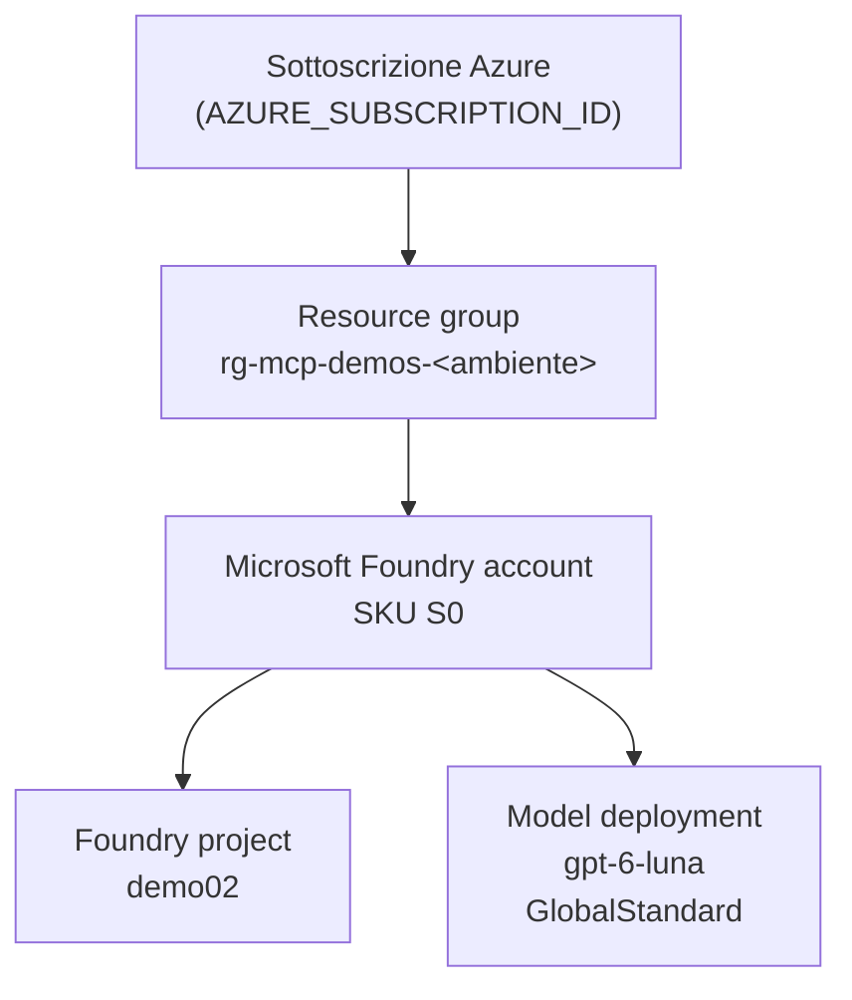

# Infrastruttura AZD

Questa cartella contiene l'infrastruttura Bicep usata da Azure Developer CLI
(AZD), collegata tramite `azure.yaml` (`infra.path: ./infra`, modulo `main`).
Il provisioning crea le risorse necessarie a Demo 02; non distribuisce né avvia
l'applicazione .NET.

## Risorse create

AZD avvia un deployment Bicep a livello di sottoscrizione. Il template crea un
resource group il cui nome include l'ambiente (`rg-mcp-demos-<ambiente>`), poi
distribuisce al suo interno un account Microsoft Foundry, un progetto e il
deployment del modello `gpt-6-luna` con SKU `GlobalStandard`.



Il template espone come output AZD il nome del resource group, il nome
dell'account Foundry, il suo endpoint, il nome del progetto e il nome del
deployment. Non espone chiavi o altri segreti.

## Prerequisiti e parametri

- Azure CLI e Azure Developer CLI (`azd`) installati.
- Accesso alla sottoscrizione e autorizzazioni per creare un resource group e
  risorse Microsoft Foundry.
- Login effettuato con `az login` e `azd auth login`.
- Un nome ambiente AZD non vuoto (massimo 77 caratteri).
- `AZURE_SUBSCRIPTION_ID`: ID della sottoscrizione di destinazione.
- `AZURE_LOCATION`: regione del resource group, account Foundry e deployment.
  Il template accetta soltanto regioni abilitate per `gpt-6-luna` con SKU
  Global Standard:
  `australiaeast`, `brazilsouth`, `canadacentral`, `canadaeast`, `centralus`,
  `eastus`, `eastus2`, `francecentral`, `germanywestcentral`, `italynorth`,
  `japaneast`, `koreacentral`, `northcentralus`, `norwayeast`,
  `polandcentral`, `southafricanorth`, `southcentralus`, `southindia`,
  `southeastasia`, `spaincentral`, `swedencentral`, `switzerlandnorth`,
  `switzerlandwest`, `uaenorth`, `uksouth`, `westeurope`, `westus`, `westus3`.

Il nome dell'ambiente è quello fornito a `azd env new`; AZD lo passa come
`AZURE_ENV_NAME`. Il file `main.bicepparam` legge queste tre variabili
direttamente con `readEnvironmentVariable`. Versione del modello e capacità
non sono fissate dal template: vengono lasciate ai valori predefiniti del
provider.

## Creare l'ambiente e fare il provisioning

Dalla directory principale del repository:

```powershell
az login
azd auth login

azd env new demo02-dev
azd env set AZURE_SUBSCRIPTION_ID <id-sottoscrizione>
azd env set AZURE_LOCATION eastus2

azd provision -e demo02-dev
```

Sostituisci `demo02-dev`, l'ID e `eastus2` con i valori desiderati. La regione
deve essere una di quelle elencate sopra. Se l'ambiente esiste già, selezionalo
con `azd env select demo02-dev` e aggiorna, se necessario, i parametri con
`azd env set`.

In alternativa, `azd up -e demo02-dev` esegue il provisioning e poi tenta le
fasi applicative previste dal progetto. Per il solo deploy delle risorse
infrastrutturali usa `azd provision`.

## Verifica e rimozione

Per visualizzare gli output del provisioning:

```powershell
azd env get-values -e demo02-dev
```

Per eliminare le risorse create nell'ambiente (inclusi account, progetto e
deployment del modello):

```powershell
azd down -e demo02-dev
```

La rimozione è distruttiva e cancella le risorse nel resource group
dell'ambiente.
