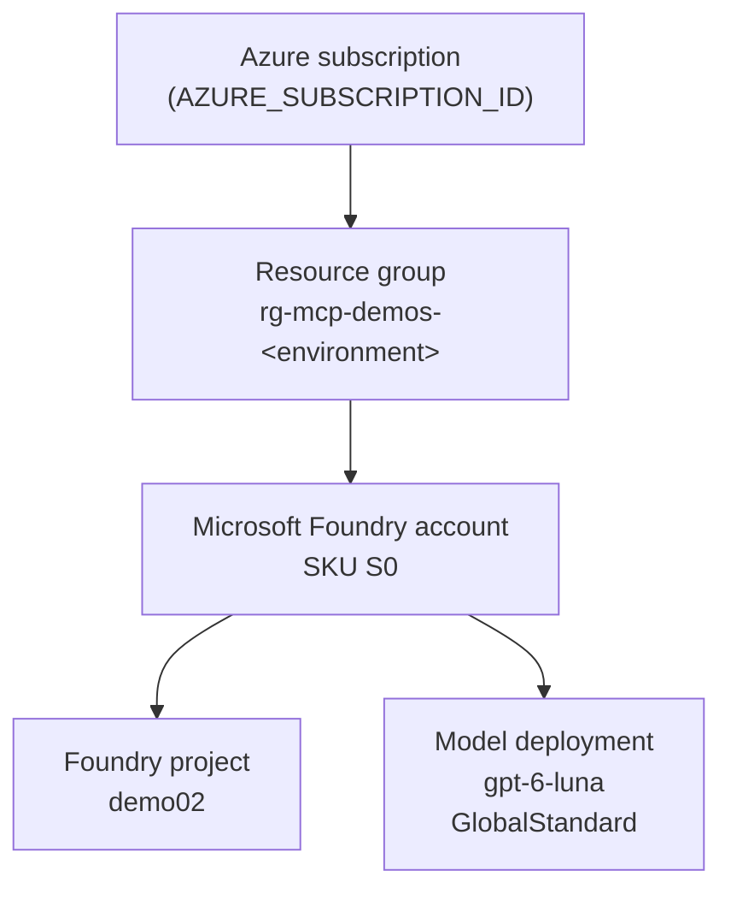

# AZD Infrastructure

This folder contains the Bicep infrastructure used by Azure Developer CLI
(AZD), configured through `azure.yaml` (`infra.path: ./infra`, module `main`).
Provisioning creates the resources required by Demo 02; it does not deploy or
start the .NET application.

## Resources created

AZD starts a subscription-scoped Bicep deployment. The template creates a
resource group whose name includes the environment (`rg-mcp-demos-<environment>`),
then deploys a Microsoft Foundry account, a project, and the `gpt-6-luna` model
deployment with the `GlobalStandard` SKU into it.



The template exposes the resource group name, Foundry account name and
endpoint, project name, and deployment name as AZD outputs. It does not expose
keys or other secrets.

## Prerequisites and parameters

- Azure CLI and Azure Developer CLI (`azd`) installed.
- PowerShell 7 (`pwsh`) on the `PATH`, including on Linux/macOS, and a .NET SDK
  compatible with the `net10.0` project. The `postprovision` hook and the
  `azd hooks run postprovision` command have been verified with stable AZD
  1.37.3, without preview features.
- Access to the subscription and permissions to create a resource group and
  Microsoft Foundry resources.
- The Azure CLI identity must have the
  `Microsoft.CognitiveServices/accounts/listKeys/action` permission on the
  Foundry account. AZD login alone does not necessarily authenticate Azure CLI.
- Logged in with `az login` and `azd auth login`.
- A non-empty AZD environment name (up to 77 characters).
- `AZURE_SUBSCRIPTION_ID`: ID of the target subscription.
- `AZURE_LOCATION`: region for the resource group, Foundry account, and
  deployment. The template accepts only regions where `gpt-6-luna` with the
  Global Standard SKU is available:
  `australiaeast`, `brazilsouth`, `canadacentral`, `canadaeast`, `centralus`,
  `eastus`, `eastus2`, `francecentral`, `germanywestcentral`, `italynorth`,
  `japaneast`, `koreacentral`, `northcentralus`, `norwayeast`,
  `polandcentral`, `southafricanorth`, `southcentralus`, `southindia`,
  `southeastasia`, `spaincentral`, `swedencentral`, `switzerlandnorth`,
  `switzerlandwest`, `uaenorth`, `uksouth`, `westeurope`, `westus`, `westus3`.

The environment name is the one provided to `azd env new`; AZD passes it as
`AZURE_ENV_NAME`. The `main.bicepparam` file reads these three variables
directly with `readEnvironmentVariable`. The template does not pin the model
version or capacity; these are left to the provider defaults.

## Create the environment and provision

From the repository root:

```powershell
az login
azd auth login

azd env new demo02-dev
azd env set AZURE_SUBSCRIPTION_ID <subscription-id>
azd env set AZURE_LOCATION eastus2

azd provision -e demo02-dev
```

Replace `demo02-dev`, the ID, and `eastus2` with the values you want. The
region must be one of those listed above. If the environment already exists,
select it with `azd env select demo02-dev` and update the parameters with
`azd env set` if needed.

Alternatively, `azd up -e demo02-dev` provisions the infrastructure and then
attempts the application's deployment phases defined by the project. Use
`azd provision` to deploy infrastructure resources only.

## Automatic local configuration for Demo 02

After successful provisioning, the root `postprovision` hook in `azure.yaml`
runs `scripts/azd/initialize-demo02-secrets.ps1`. It uses the non-secret
outputs `resourceGroupName`, `foundryAccountName`, and `foundryEndpoint`, along
with the `AZURE_SUBSCRIPTION_ID` value from the selected environment. Azure CLI
retrieves `key1` from the account in that subscription; the key is held in
memory and passed as JSON through stdin to `dotnet user-secrets set --project`,
together with the endpoint.

The `src/MCP-Demos.02-MCPChat` project already has a `UserSecretsId`; there is
no need to run `dotnet user-secrets init`. The settings written are
`Foundry:Endpoint` and `Foundry:ApiKey`, the same names read by the
application. The model remains the `gpt-6-luna` deployment expected by the
project.

The hook does not print the values or place the key in process arguments,
temporary files, Bicep outputs, or the `.azure` environment. It also
suppresses the output of commands that handle the key, including error output,
and instead reports the failed phase and checks to perform. An error causes
the hook to exit with a non-zero code and fails the AZD command; resources
already created are not automatically deleted. Do not run setup with tracing,
PowerShell transcripts, or debug logging enabled for commands that handle
credentials.

User secrets are a local **unencrypted** store outside the repository,
intended for development only. Run provisioning/the hook and the application
as the same operating system user. The hook updates only these two settings
and preserves other user secrets; changing the AZD environment overwrites the
Demo 02 values for the current user. Do not use this store to distribute
production credentials.

To repeat only the local configuration without provisioning again:

```powershell
# If the local outputs are out of date, synchronize them from Azure:
azd env refresh -e demo02-dev
azd hooks run postprovision -e demo02-dev --no-prompt

dotnet run --project .\src\MCP-Demos.02-MCPChat
```

Refreshing and retrieving the key require access to Azure, but the
`hooks run` command does not create resources. If the key is rotated, run the
hook again. Do not use `dotnet user-secrets list` for a shared verification:
it would also display the key.

### Local verification without deployment

From the repository root:

```powershell
az bicep build --file .\infra\main.bicep --stdout | Out-Null
pwsh -NoProfile -File .\scripts\azd\tests\Test-Demo02Secrets.ps1
```

The test uses a fake key and an isolated temporary profile. It verifies the
actual import through .NET, value replacement, preservation of unrelated
settings, and the cases of missing outputs, invalid endpoint, empty/invalid
key, Azure CLI error, and write error. It checks that values do not appear in
the output. It also runs the actual `azd hooks run postprovision` against a
temporary copy of `azure.yaml`, with an intentionally invalid endpoint,
verifying environment loading and error propagation before any request to
Azure. It does not provision resources, retrieve real keys, or modify the
repository's selected AZD environment, and it removes the temporary profile
when finished.

### Linux compatibility

The same PowerShell hook runs on Windows and Linux: `shell: pwsh` is
explicit, with no `windows` restriction in `azure.yaml`. Linux requires
native PowerShell 7, .NET SDK, Azure CLI, and AZD on `PATH`; Bash alone is
not sufficient. In WSL, do not use Windows Azure CLI or Windows .NET for
this workflow.

All nine offline checks passed on Ubuntu 24.04.4 (WSL), PowerShell 7.5.4,
.NET SDK 10.0.404, and AZD 1.37.3, including actual imports into the Linux
user secrets store and hook execution through native Linux AZD. The same
suite also passed again on Windows. Azure CLI key retrieval is simulated in
these tests; they do not verify access to a real Azure account.

To repeat the tests from Bash at the repository root:

```bash
pwsh -NoProfile -File ./scripts/azd/tests/Test-Demo02Secrets.ps1
```

On Linux, the test unsets `APPDATA` and isolates `HOME`, checking the
`.microsoft/usersecrets` store inside the temporary profile. The hook itself
does not set these variables: normal execution uses the current user's
profile.

## Verification and cleanup

To view the provisioning outputs:

```powershell
azd env get-values -e demo02-dev
```

To delete the resources created for the environment (including the account,
project, and model deployment):

```powershell
azd down -e demo02-dev
```

This is destructive and deletes the resources in the environment's resource
group.
