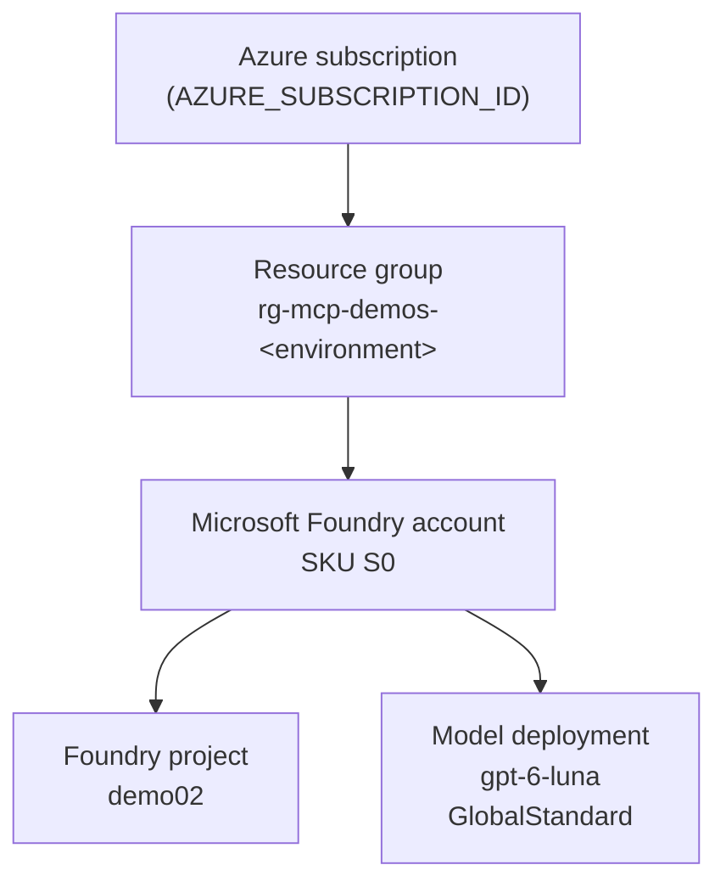
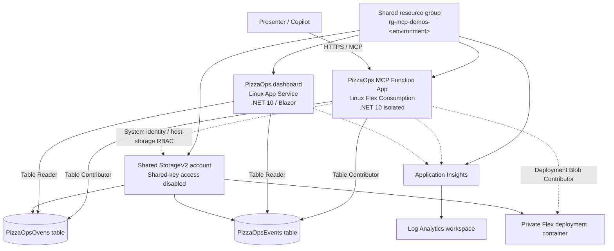

# AZD Infrastructure

This folder contains the Bicep infrastructure used by Azure Developer CLI
(AZD), configured through `azure.yaml` (`infra.path: ./infra`, module `main`).
The subscription-scoped entry point provisions Demo 02 and PizzaOps resources
into the environment's resource group; it does not deploy or start either
.NET application. The root [azure.yaml](../azure.yaml) separately defines
exactly two deployable services: `pizzaops-functions` (`function`) and
`pizzaops-dashboard` (`appservice`). DemoAdmin and storage are not services.

## Chat with tools (Demo 02)

AZD starts a subscription-scoped Bicep deployment. The template creates a
resource group whose name includes the environment (`rg-mcp-demos-<environment>`),
then deploys a Microsoft Foundry account, a project, and the `gpt-6-luna` model
deployment with the `GlobalStandard` SKU into it.



The template exposes the resource group name, Foundry account name and
endpoint, project name, and deployment name as AZD outputs. It does not expose
keys or other secrets.

## PizzaOps resources (Demo 03)

The root `main.bicep` also invokes `modules/pizzaops.bicep` in that same
resource group. It adds one Linux Flex Consumption Functions app and plan, one
Linux App Service dashboard and plan, one shared StorageV2 account, the
`PizzaOpsOvens` and `PizzaOpsEvents` tables, a private Flex deployment
container, Application Insights, and its Log Analytics workspace. Every
PizzaOps resource is tagged `demo: '03'`; existing Demo 02 names, tags,
outputs remain unchanged. The root `postprovision` hook retains its local
behavior.



The PizzaOps app and dashboard have system-assigned identities. The dashboard
gets only `Storage Table Data Reader` on each application table. Functions
gets `Storage Table Data Contributor` on both tables, and the host-storage
permissions required by identity-based Functions storage: `Storage Blob Data
Owner`, `Storage Queue Data Contributor`, and `Storage Table Data Contributor`
at the account scope. Its Flex deployment identity also receives
`Storage Blob Data Contributor` on the deployment container. The account
disallows shared-key access; its HTTPS endpoints remain enabled with public
network access, so data-plane access is enforced by Entra ID/RBAC rather than
network isolation. Both app identities receive `Monitoring Metrics Publisher`
on Application Insights, which has local authentication disabled.

The optional `PIZZAOPS_OPERATOR_PRINCIPAL_ID` setting grants the supplied
principal `Storage Table Data Contributor` on only the two PizzaOps tables.
Leave it unset unless the authorized reset operator and deployment target are
known.

### PizzaOps environment settings

[`main.bicepparam`](main.bicepparam) reads the three required AZD values
`AZURE_ENV_NAME`, `AZURE_SUBSCRIPTION_ID`, and `AZURE_LOCATION`, plus the
following optional operator settings:

| AZD value | Default | Effect |
| --- | --- | --- |
| `PIZZAOPS_OPERATOR_PRINCIPAL_ID` | Empty | Optional user, group, or service-principal object ID for reset-table access. |
| `PIZZAOPS_OPERATOR_PRINCIPAL_TYPE` | `User` | Set to `Group` or `ServicePrincipal` when the optional operator ID has that type. |

The current [`pizzaops.bicep`](modules/pizzaops.bicep) fixes the dashboard
plan to **Linux B1 with Always On enabled** and configures **one Flex
always-ready instance in the `http` group**. There is no `dev`/`demo` profile,
S1 selection, or environment-variable override for these settings.
`PIZZAOPS_PROFILE` and `PIZZAOPS_FUNCTIONS_ALWAYS_READY_HTTP_INSTANCES` are
not read by the current templates; setting them in AZD does not change cost
or scaling. Confirm that `http` is the appropriate supported scaling group
for the deployed MCP extension before treating it as a latency mitigation.

The Flex app uses runtime `dotnet-isolated` version `10`, Functions v4, a
2-GiB instance size, and a maximum of 40 instances. Its deployment package is
configured for the system-assigned identity, while `AzureWebJobsStorage` uses
the identity-based `accountName`/`credential=managedidentity` settings.
App Service uses the built-in `DOTNETCORE|10.0` stack, HTTPS-only, TLS 1.2,
WebSockets, and `/health/ready`. Both apps receive the Table endpoint and
validated table/partition names through app settings. No MCP key is emitted
as an output or configured by this infrastructure.

On Flex Consumption, the runtime name and version are configured only through
`functionAppConfig.runtime`. Do not add `FUNCTIONS_WORKER_RUNTIME` or
`FUNCTIONS_WORKER_RUNTIME_VERSION` app settings; `FUNCTIONS_EXTENSION_VERSION`
is managed by the platform and must also be omitted. These legacy settings
can cause `azd provision` to fail with `BadRequest` even after the Function
App has been created. After correcting the template, rerun `azd provision`
against the same environment; this error does not require deleting resources.
See the [Flex Consumption app-setting deprecations](https://learn.microsoft.com/azure/azure-functions/functions-app-settings#flex-consumption-plan-deprecations).

The pre-existing `AZURE_LOCATION` allowlist remains the Foundry policy and
still determines the resource-group location. It is not a statement that
Flex .NET 10, App Service .NET 10, or the MCP extension is available there.
The AZD parameter file deliberately supplies **the same `AZURE_LOCATION` to
both demos**; there is no `PIZZAOPS_LOCATION` environment override or
`pizzaOpsLocation` root Bicep parameter.
Choose a region satisfying both Foundry and PizzaOps runtime/service
requirements before requesting target approval.

Use explicit named environments such as `mcp-demos-dev` or `mcp-demos-demo`,
but note that the name does not select different compute settings. B1 plan
charges and the Flex always-ready baseline accrue even without tool calls.
Flex execution, storage, telemetry ingestion/retention, and any network
charges are additional; Demo 02 model usage is separate. Obtain an estimate
for the selected region, expected usage, and resource lifetime, and approve
the costs before provisioning. Changing cost-bearing settings requires a
reviewed Bicep change, not an unused AZD value.

## Prerequisites and parameters

- Azure CLI and Azure Developer CLI (`azd`) 1.38.0 or later installed.
- PowerShell 7 (`pwsh`) on the `PATH`, including on Linux/macOS, and a .NET SDK
  compatible with the `net10.0` project. The `postprovision` hook and the
  `azd hooks run postprovision` command and packaging have been verified with
  stable AZD 1.38.0. AZD still labels `package` Beta in its command help.
- Management permissions for subscription-scope deployments/resource-group
  creation and the target group's Foundry, Web, Storage, Insights, and
  Operational Insights resources.
- Permission to create the declared role assignments
  (`Microsoft.Authorization/roleAssignments/write`) at their target scopes.
  Contributor alone does not grant this permission; have an administrator
  review scoped RBAC administration rights rather than assuming subscription
  Owner is required.
- Code deployment permissions on both apps, plus AZD resource discovery and
  deployment-output read access. Reset is separate: its operator needs Table
  Data Contributor on both application tables, not storage account keys.
- The Azure CLI identity must have the
  `Microsoft.CognitiveServices/accounts/listKeys/action` permission on the
  Foundry account. AZD login alone does not necessarily authenticate Azure CLI.
- Logged in with `az login` and `azd auth login`.
- A non-empty AZD environment name (up to 77 characters).
- `AZURE_SUBSCRIPTION_ID`: ID of the target subscription.
- `AZURE_LOCATION`: region for the resource group, Foundry account, and
  deployment. The template accepts only regions where `gpt-6-luna` with the
  Global Standard SKU is available:
  `australiaeast`, `brazilsouth`, `canadacentral`, `canadaeast`, `centralus`,
  `eastus`, `eastus2`, `francecentral`, `germanywestcentral`, `italynorth`,
  `japaneast`, `koreacentral`, `northcentralus`, `norwayeast`,
  `polandcentral`, `southafricanorth`, `southcentralus`, `southindia`,
  `southeastasia`, `spaincentral`, `swedencentral`, `switzerlandnorth`,
  `switzerlandwest`, `uaenorth`, `uksouth`, `westeurope`, `westus`, `westus3`.

The environment name is the one provided to `azd env new`; AZD passes it as
`AZURE_ENV_NAME`. The `main.bicepparam` file reads the existing three required
variables and the optional operator settings with
`readEnvironmentVariable`. The Foundry module sets model deployment capacity
to `50`; the model version is not pinned and is left to the provider.

## Create the environment and provision

From the repository root:

```powershell
az login
azd auth login

azd env new demo02-dev
azd env set AZURE_SUBSCRIPTION_ID <subscription-id> -e demo02-dev
azd env set AZURE_LOCATION eastus2 -e demo02-dev

# Optional: authorize the reviewed reset operator on both application tables.
azd env set PIZZAOPS_OPERATOR_PRINCIPAL_ID <operator-object-id> -e demo02-dev
azd env set PIZZAOPS_OPERATOR_PRINCIPAL_TYPE User -e demo02-dev

# Only after target, permissions, what-if, runtime support and costs are approved.
azd provision --cwd .\src\MCP-Demos03-PizzaOps -e demo02-dev
```

Replace `demo02-dev`, the ID, and `eastus2` with the values you want. The
region must be one of those listed above for Demo 02 and also support PizzaOps.
If the environment already exists, select it with `azd env select demo02-dev`
and update the parameters with `azd env set` if needed. Do not run
`azd provision`, `azd up`, or an Azure what-if until the subscription,
environment, tenant, shared region, optional operator principal, and intended
resource changes have been reviewed and explicitly approved. Root provisioning
includes Demo 02, not just PizzaOps, and its local postprovision hook retrieves
the Foundry key into the current user's existing .NET user-secrets store.
Approve that side effect too; no hook retrieves the PizzaOps MCP key.

### Package, provision, deploy, and reset are different operations

Run these examples from the repository root, only against a reviewed target:

```powershell
# Local build/package only; no Azure login or resource changes.
azd package --cwd .\src\MCP-Demos03-PizzaOps --all -e demo02-dev --no-prompt
# Shared infrastructure, tables and RBAC; local Demo 02 postprovision hook runs.
azd provision --cwd .\src\MCP-Demos03-PizzaOps -e demo02-dev
# Application code only; preserves kitchen data and does not run postprovision.
azd deploy --cwd .\src\MCP-Demos03-PizzaOps --all -e demo02-dev
# Combined package/provision/deploy lifecycle, not a kitchen reset.
azd up --cwd .\src\MCP-Demos03-PizzaOps -e demo02-dev
```

**Keep the explicit `--cwd` on commands that build code.** AZD finds the root
manifest by walking up from the PizzaOps solution. In AZD 1.38.0 a bare
root `azd package` runs .NET from the root, not the service directory:
verification found SDK 11 preview despite the scoped `global.json`.
With the shown option, both actual publish builds used SDK **10.0.404**.
There is no root SDK pin or second/custom publishing implementation.
Use absolute `--output-path` paths when retaining packages, because relative
paths are resolved against the selected working directory.

The Function App and dashboard carry matching `azd-service-name` tags.
AZD discovers the shared resource group through its existing `azd-env-name`
tag; the existing camel-case Demo 02 and PizzaOps name/ID/endpoint outputs
remain unchanged and nonsecret. No duplicate uppercase output is required.
Discovery uses the tags, not hard-coded app names. The two
deployable projects have stable `UserSecretsId` values so AZD initialization
does not edit project files. AZD may materialize **nonsecret infrastructure
outputs** in their local user-secret stores; no MCP key is an output.

The Function App uses Flex (`FC1`/`FlexConsumption`), not classic Consumption.
AZD 1.38.0's [function target](https://github.com/Azure/azure-dev/blob/azure-dev-cli_1.38.0/cli/azd/pkg/project/service_target_functionapp.go)
reads the actual plan and chooses its Flex deployment API rather than the
regular ZipDeploy path. Flex uses
[One Deploy](https://learn.microsoft.com/azure/azure-functions/functions-deployment-technologies#one-deploy).
`remoteBuild: false` sends the locally published ZIP as-is. The Bicep
`functionAppConfig.deployment.storage` configures the private blob container
and system identity; do not add classic `WEBSITE_RUN_FROM_PACKAGE`,
storage keys, Oryx settings, or a parallel `func publish` pipeline.
ZIP checks cover the .NET 10 runtime, host/extension files, and the SDK 1.0.0
`worker.config.json` worker-indexing contract (no legacy `functions.metadata`
file is required). This is local/package and implementation evidence, **not**
proof of runtime availability or a successful Azure deployment.

Provisioning creates empty tables. Deployment never seeds/resets them or
retrieves the MCP key. After deployment, `/health/live` should respond; an
empty or incomplete kitchen correctly makes `/health/ready` return 503.
Use the separately authorized [operator procedure](../src/MCP-Demos03-PizzaOps/README.md#operator-reset-and-status)
to pause/drain calls, explicitly reset, and verify status before resuming.
Then verify readiness, dashboard state, real managed-identity/RBAC behavior,
and authenticated MCP discovery in Task 13. A failed provision/deploy does
not trigger automatic reset, rollback, or deletion.

### Code rollback

Retain the **pair** of known-good packages and their SHA-256 hashes before
deployment. For code rollback, verify those hashes, refresh the intended
environment, and deploy each package with the same native path:

```powershell
azd env refresh -e demo02-dev
azd deploy pizzaops-functions --cwd .\src\MCP-Demos03-PizzaOps -e demo02-dev --from-package <absolute-functions-zip>
azd deploy pizzaops-dashboard --cwd .\src\MCP-Demos03-PizzaOps -e demo02-dev --from-package <absolute-dashboard-zip>
```

Obtain target approval first; confirm runtime/configuration compatibility and
recheck liveness/readiness afterward. Deploying the pair is not atomic; pause
calls while recovering a partial rollout. Code rollback does not roll back
Bicep, table data, identities or keys, and is never an excuse to run `azd down`.

## Automatic local configuration for Demo 02

After successful provisioning, the root `postprovision` hook in `azure.yaml`
runs `scripts/azd/initialize-demo02-secrets.ps1`. It uses the non-secret
outputs `resourceGroupName`, `foundryAccountName`, and `foundryEndpoint`, along
with the `AZURE_SUBSCRIPTION_ID` value from the selected environment. Azure CLI
retrieves `key1` from the account in that subscription; the key is held in
memory and passed as JSON through stdin to `dotnet user-secrets set --project`,
together with the endpoint.

The `src/MCP-Demos.02-MCPChat` project already has a `UserSecretsId`; there is
no need to run `dotnet user-secrets init`. The settings written are
`Foundry:Endpoint` and `Foundry:ApiKey`, the same names read by the
application. The model remains the `gpt-6-luna` deployment expected by the
project.

The hook does not print the values or place the key in process arguments,
temporary files, Bicep outputs, or the `.azure` environment. It also
suppresses the output of commands that handle the key, including error output,
and instead reports the failed phase and checks to perform. An error causes
the hook to exit with a non-zero code and fails the AZD command; resources
already created are not automatically deleted. Do not run setup with tracing,
PowerShell transcripts, or debug logging enabled for commands that handle
credentials.

User secrets are a local **unencrypted** store outside the repository,
intended for development only. Run provisioning/the hook and the application
as the same operating system user. The hook updates only these two settings
and preserves other user secrets; changing the AZD environment overwrites the
Demo 02 values for the current user. Do not use this store to distribute
production credentials.

To repeat only the local configuration without provisioning again:

```powershell
# If the local outputs are out of date, synchronize them from Azure:
azd env refresh -e demo02-dev
azd hooks run postprovision -e demo02-dev --no-prompt

dotnet run --project .\src\MCP-Demos.02-MCPChat
```

Refreshing and retrieving the key require access to Azure, but the
`hooks run` command does not create resources. If the key is rotated, run the
hook again. Do not use `dotnet user-secrets list` for a shared verification:
it would also display the key.

### Local verification without deployment

From the repository root:

```powershell
az bicep build --file .\infra\main.bicep --stdout | Out-Null
pwsh -NoProfile -File .\scripts\azd\tests\Test-Demo02Secrets.ps1
pwsh -NoProfile -File .\scripts\azd\tests\Test-PizzaOpsPackage.ps1
```

[`Test-PizzaOpsInfrastructure.ps1`](../scripts/azd/tests/Test-PizzaOpsInfrastructure.ps1)
still asserts the removed `dev`/`demo` and `pizzaOpsLocation` parameters, so
its full run is currently blocked by stale expectations. Bicep compilation
alone does not replace those checks or prove Azure compatibility.

The Demo 02 hook test uses a fake key and an isolated temporary profile. It verifies the
actual import through .NET, value replacement, preservation of unrelated
settings, and the cases of missing outputs, invalid endpoint, empty/invalid
key, Azure CLI error, and write error. It checks that values do not appear in
the output. It also runs the actual `azd hooks run postprovision` against a
temporary copy of `azure.yaml`, with an intentionally invalid endpoint,
verifying environment loading and error propagation before any request to
Azure. It does not provision resources, retrieve real keys, or modify the
repository's selected AZD environment, and it removes the temporary profile
when finished.

The packaging test copies only nonignored source inputs into a
temporary repository-root layout, isolates AZD/profile state, reuses the NuGet
cache, instruments the actual MSBuild publish SDK, validates both ZIPs, and
cleans up. It never selects or refreshes the developer's active environment.
Both packages passed with SDK 10.0.404 even with SDK 11 preview installed.
The earlier dev/demo parameter-profile checks do not validate the current
simplified templates. Live Azure runtime, RBAC, authentication, telemetry, and dashboard
latency remain Task 13 acceptance gates, not outcomes of these offline tests.

### Linux compatibility

The same PowerShell hook runs on Windows and Linux: `shell: pwsh` is
explicit, with no `windows` restriction in `azure.yaml`. Linux requires
native PowerShell 7, .NET SDK, Azure CLI, and AZD on `PATH`; Bash alone is
not sufficient. In WSL, do not use Windows Azure CLI or Windows .NET for
this workflow.

All nine offline checks passed on Ubuntu 24.04.4 (WSL), PowerShell 7.5.4,
.NET SDK 10.0.404, and AZD 1.37.3, including actual imports into the Linux
user secrets store and hook execution through native Linux AZD. The same
suite also passed again on Windows. Azure CLI key retrieval is simulated in
these tests; they do not verify access to a real Azure account.

To repeat the tests from Bash at the repository root:

```bash
pwsh -NoProfile -File ./scripts/azd/tests/Test-Demo02Secrets.ps1
```

On Linux, the test unsets `APPDATA` and isolates `HOME`, checking the
`.microsoft/usersecrets` store inside the temporary profile. The hook itself
does not set these variables: normal execution uses the current user's
profile.

## Verification and cleanup

Read only the nonsecret outputs needed for verification, rather than dumping
the entire AZD environment (which may contain unrelated local values):

```powershell
azd env get-value pizzaOpsDashboardUrl -e demo02-dev
azd env get-value pizzaOpsFunctionAppName -e demo02-dev
```

To delete the resources created for the environment (including both demos):

```powershell
azd down -e demo02-dev
```

**Shared-resource destruction:** root `azd down` deletes the shared environment,
including Demo 02 Foundry resources and PizzaOps storage/data, plans, apps and
telemetry. It is not a PizzaOps reset or routine recovery step. Obtain explicit
approval from both demos' owners, confirm the environment/subscription and
resource inventory, and back up needed data first. Never run cleanup
automatically after a failed deployment. Prefer the explicit kitchen reset for
rehearsal; if only PizzaOps must be removed, plan a separately reviewed,
resource-scoped removal rather than deleting the shared group.
