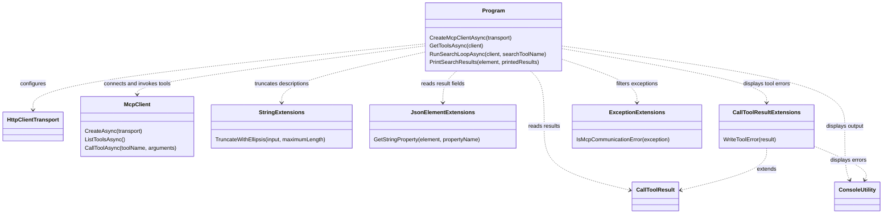

# Demo 01 - MCP Client for Microsoft Learn

A .NET 10 console application that uses the C# Model Context Protocol (MCP) SDK to search Microsoft Learn documentation. It connects directly to the remote MCP server; no language model or local MCP server is required.

## How it works

1. Configure Streamable HTTP transport for `https://learn.microsoft.com/api/mcp`.
2. Create the MCP client and initialize the connection.
3. Retrieve the available tools through `tools/list`.
4. Display tool names and descriptions, truncating descriptions to at most 200 characters.
5. Verify that `microsoft_docs_search` is available.
6. Read search topics, call the tool with the `query` argument, and display each result's `title` and `contentUrl`.

Search results are read from structured content and JSON text blocks. Duplicate title/URL pairs are displayed only once per search.

Empty or whitespace-only input is ignored. Enter `/quit` (case-insensitive) or end the input stream to exit. Client and transport cleanup is performed asynchronously through `await using`.

## Project structure

| File or folder | Purpose |
| --- | --- |
| [Program.cs](./Program.cs) | Entry point and local functions for client creation, tool discovery, the interactive loop, and result display. |
| [MCP-Demos.01-MCPClient.csproj](./MCP-Demos.01-MCPClient.csproj) | .NET 10 console project with references to `ModelContextProtocol.Core` and the shared Core project. |
| [MCP-Demos.Core](../MCP-Demos.Core) | Shared library containing console utilities and extension methods. |
| [ConsoleUtility.cs](../MCP-Demos.Core/Utilities/ConsoleUtility.cs) | Colored console output. |
| [StringExtensions.cs](../MCP-Demos.Core/Extensions/StringExtensions.cs) | Truncates tool descriptions with an ellipsis within the requested length. |
| [JsonElementExtensions.cs](../MCP-Demos.Core/Extensions/JsonElementExtensions.cs) | Retrieves string-valued JSON properties using case-insensitive names. |
| [CallToolResultExtensions.cs](../MCP-Demos.Core/Extensions/CallToolResultExtensions.cs) | Displays tool-level error details. |
| [ExceptionExtensions.cs](../MCP-Demos.Core/Extensions/ExceptionExtensions.cs) | Classifies expected MCP communication errors for exception filters. |

## Class diagram

`Program` represents the top-level entry point and its local functions. MCP client, transport, and result types are provided by the SDK; the utilities and extensions belong to Core.



## Prerequisites

- .NET 10 SDK or a compatible newer SDK.
- Internet access to NuGet for the initial package restore and to `https://learn.microsoft.com/api/mcp` at runtime.

The demo does not configure credentials or API keys.

## Run

From the repository root, run:

```powershell
dotnet run --project .\src\MCP-Demos.01-MCPClient\MCP-Demos.01-MCPClient.csproj
```

This command restores dependencies and builds both the client and its referenced Core library before starting the application.

To build without running:

```powershell
dotnet build .\src\MCP-Demos.01-MCPClient\MCP-Demos.01-MCPClient.csproj
```

After the tool list appears, enter a topic such as `Azure Functions`. Output follows this format; actual results depend on the service:

```text
Search topic (or /quit): Azure Functions
Title: What is Azure Functions? - URL: https://learn.microsoft.com/azure/azure-functions/functions-overview

Search topic (or /quit): /quit
```

## Error handling

- Connection or tool-list failures, or a missing search tool, stop startup with exit code `1`.
- Expected MCP communication errors during a search are reported without ending the interactive loop.
- Tool-level failures (`IsError`) display the returned text error details.
- Non-JSON text blocks are skipped during JSON parsing. If no result with string-valued `title` and `contentUrl` fields is found, the application reports this and writes the text response to standard error.
- Normal completion returns exit code `0`. Unexpected exceptions are not intercepted by the communication-error filters.

## References

- [Microsoft Learn MCP Server overview](https://learn.microsoft.com/en-us/training/support/mcp)
- [Microsoft Learn MCP developer reference](https://learn.microsoft.com/en-us/training/support/mcp-developer-reference)
- [C# MCP SDK](https://github.com/modelcontextprotocol/csharp-sdk)
