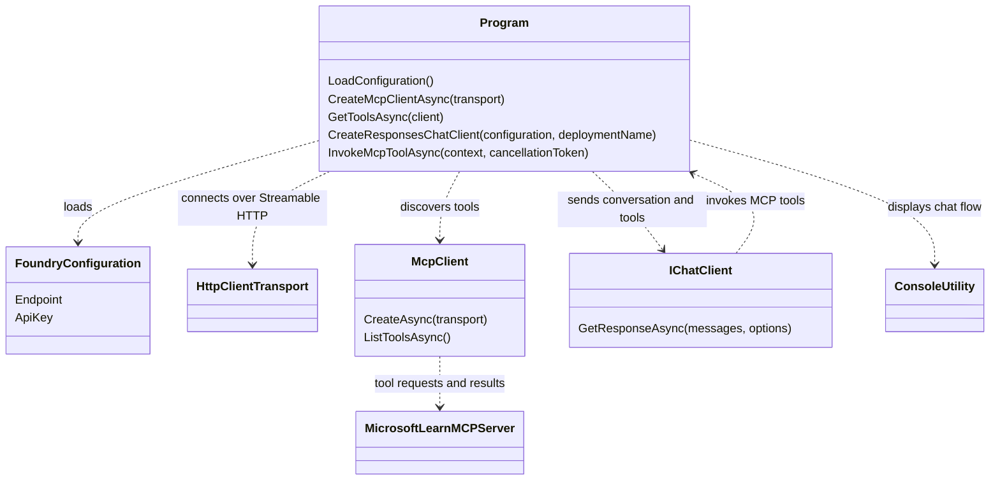

# Demo 02 - MCP Chat

A .NET 10 console chat that connects to the `gpt-6-luna` model in Microsoft Foundry and makes tools from the Microsoft Learn MCP server available to the model.

## How it works

1. The application loads the Foundry endpoint and API key from this project's .NET user secrets.
2. It connects to `https://learn.microsoft.com/api/mcp` over Streamable HTTP and discovers the server's current tools.
3. Each user message is sent to the Foundry model with the conversation history, system instructions, and discovered tools.
4. If the model requests a tool, Microsoft.Extensions.AI invokes it through the MCP client. The application displays the tool name and arguments, then passes the returned result back to the model.
5. The final model response is displayed and retained in the conversation history. Enter `/quit` (case-insensitive) or end standard input to exit.

The console labels user messages, model responses, and tool calls. Successful raw tool results are passed to the model, not printed separately. Connection, tool invocation, and Foundry request errors are reported; a failed turn is not kept in conversation history.

## Project structure

| File or folder | Purpose |
| --- | --- |
| [Program.cs](./Program.cs) | Loads configuration, connects to Microsoft Learn, discovers tools, creates the Foundry chat client, and runs the interactive loop. |
| [FoundryConfiguration.cs](./FoundryConfiguration.cs) | Holds the validated Foundry endpoint and API key. |
| [MCP-Demos.02-MCPChat.csproj](./MCP-Demos.02-MCPChat.csproj) | .NET 10 console project and dependencies for Foundry, Microsoft.Extensions.AI, user secrets, and the MCP client. |
| [MCP-Demos.Core](../MCP-Demos.Core) | Shared project, including colored console output and error-classification helpers. |
| [azure.yaml](../../azure.yaml) | Connects AZD provisioning to the Bicep infrastructure and runs the post-provision secrets hook. |
| [infra/main.bicep](../../infra/main.bicep) and [infra/modules/foundry.bicep](../../infra/modules/foundry.bicep) | Create the resource group, Foundry account and project, and model deployment. |
| [initialize-demo02-secrets.ps1](../../scripts/azd/initialize-demo02-secrets.ps1) | Retrieves the account key after provisioning and configures local .NET user secrets. |

## Class diagram

`Program` represents the top-level entry point and its local functions. MCP transport and client types, the AI chat interfaces, and function-invocation middleware are provided by their respective SDKs.



## Prerequisites

- .NET 10 SDK.
- Internet access to Microsoft Foundry and `https://learn.microsoft.com/api/mcp`.
- To provision resources: Azure CLI, Azure Developer CLI (`azd`), and PowerShell 7 (`pwsh`) on `PATH`.
- An Azure subscription with permission to create a resource group and Microsoft Foundry resources. The Azure CLI identity also needs `Microsoft.CognitiveServices/accounts/listKeys/action` on the Foundry account for the post-provision hook.
- Sign in with both `az login` and `azd auth login`.
- A region accepted by [the Bicep template](../../infra/main.bicep) and supporting the model deployment. The example below uses `eastus2`.

## Provision with AZD

Run from the repository root in PowerShell:

```powershell
az login
azd auth login

azd env new demo02-dev
azd env set AZURE_SUBSCRIPTION_ID "YOUR-SUBSCRIPTION-ID"
azd env set AZURE_LOCATION eastus2

azd provision -e demo02-dev
```

Replace `YOUR-SUBSCRIPTION-ID` with the target subscription ID.

Provisioning creates a subscription-scoped resource group named `rg-mcp-demos-<environment>`, a Microsoft Foundry account, the `demo02` project, and a `gpt-6-luna` deployment with the `GlobalStandard` SKU and capacity configured in Bicep. The `postprovision` hook then configures the local secrets for this project; AZD provisioning does not deploy or start the console application.

The hook requires the same user's .NET SDK and local profile that you will use to run the application. If the environment is already provisioned, select it with `azd env select demo02-dev`; to rerun the hook after refreshing the environment outputs, use:

```powershell
azd env refresh -e demo02-dev
azd hooks run postprovision -e demo02-dev --no-prompt
```

## Foundry credentials and user secrets

The application reads `Foundry:Endpoint` and `Foundry:ApiKey` from the project's .NET user secrets. After provisioning, the AZD hook obtains the Foundry account's `key1` and saves both values in the current user's secrets store. It passes the key to `dotnet user-secrets` through standard input rather than a command-line argument or temporary file, and suppresses CLI output that could contain credentials.

The project already has a `UserSecretsId`, so `dotnet user-secrets init` is not needed. User secrets are stored outside the repository, but are **not encrypted** and are intended for local development—not production credential storage. Run the hook and application as the same operating-system user. Do not print or share the secrets store contents.

## Run locally

From the repository root:

```powershell
dotnet run --project .\src\MCP-Demos.02-MCPChat\MCP-Demos.02-MCPChat.csproj
```

Type a question at the `[USER]` prompt. Enter `/quit` to end the chat.
