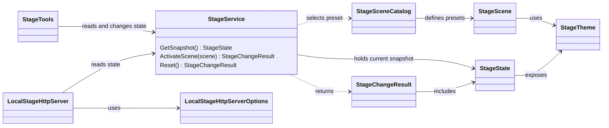

# Demo 03 — Stage Director

[Overview](#overview) · [Installation](#installation) · [Usage](#usage) · [Smoke test](#smoke-test) · [Class diagram](#class-diagram)

## Overview

Stage Director shows how GitHub Copilot can use the Model Context Protocol (MCP) to change a virtual stage during a talk. Ask for fewer distractions, more energy, or a finale, and the browser dashboard reflects the scene Copilot selects.

A single .NET 10 console process handles MCP over stdio and serves the dashboard over HTTP on `127.0.0.1`. The browser polls the read-only `GET /api/stage` endpoint; only MCP tools can change the scene. The dashboard assets are embedded in the project, and the stage state lives in memory. The server requires no cloud resources or database and does not control physical devices.

## Installation

**Prerequisites:** a local checkout of this repository, the .NET 10 SDK, and VS Code with GitHub Copilot.

Stop **stage-director** in VS Code before rebuilding if it is already running. On Windows, the running process locks the DLL. From the repository root, run:

```powershell
dotnet build .\src\MCP-Demos.03-MCPServer\StageDirector.csproj -c Release
```

Open the repository root as the VS Code workspace. The included [`.mcp.json`](../../.mcp.json) uses the `mcpServers` schema and launches the built `StageDirector.dll` directly, not through `dotnet run`. If VS Code doesn't load the root configuration, enable `chat.mcp.workspaceRootConfig.enabled` if available. See the [VS Code MCP configuration reference](https://code.visualstudio.com/docs/agents/reference/mcp-configuration) for setup details.

## Usage

1. Select the Copilot session target in VS Code. Open **Chat: Open Customizations > MCP Servers**, start **stage-director**, and approve the local server.
2. **After the MCP server connects**, open <http://127.0.0.1:5187/>. The dashboard starts in `welcome`.
3. Try the prompts below. The dashboard updates without a reload.
4. When finished, use **Stop** in VS Code to shut down the server and release the port.

> [!TIP]
> If `5187` is occupied, add `"env": { "STAGE_DIRECTOR_PORT": "5188" }` to the `stage-director` entry in [`.mcp.json`](../../.mcp.json). Choose a free port from `1024` through `65535`, restart the server, and open the dashboard on the same port.

### MCP tools

| MCP tool | What it does |
|---|---|
| `get_stage_status` | Reads the active scene, visual settings, revision, and available scene IDs. |
| `activate_scene` | Switches to the specified `scene`. Activating the current scene leaves its revision unchanged. |
| `reset_stage` | Returns to `welcome` without creating a new revision if `welcome` is already active. |

### Demo prompts

| Ask Copilot | Expected scene | On screen |
|---|---|---|
| "We're starting a technical talk. We need fewer distractions." | `focus` | Dark stage with subdued motion and `FOCUS MODE`. |
| "The audience needs some energy!" | `energy` | Purple and orange stage with gently pulsing lights. |
| "We're done. Let's have a grand finale!" | `celebration` | `THANK YOU!` and about four seconds of confetti. Repeating the request does not replay it. |
| "Reset the stage to welcome." | `welcome` | Blue, softly animated welcome screen. |

### Troubleshooting

- **Server does not start:** confirm the Release build succeeded and that the DLL path in [`.mcp.json`](../../.mcp.json) is relative to the workspace root. Check the MCP server output in VS Code for startup errors.
- **Dashboard says `DISCONNECTED`:** restart the MCP server and check the URL's port. An already-open dashboard reconnects automatically. If the page never loaded, open it again after connecting.

## Smoke test

[`Test-StageDirector.ps1`](./Test-StageDirector.ps1) runs an end-to-end smoke test against a separate Stage Director process; it does not require VS Code or a Copilot session. It checks startup errors for invalid or occupied ports, MCP discovery and tool schemas, the dashboard's HTTP routes and security headers, scene changes and reset behavior, invalid inputs, idempotency, concurrent requests, and clean shutdown. The script also confirms that the MCP status and HTTP snapshot agree.

Build the Release configuration first, then run the script from the repository root in PowerShell 7.5 or later:

```powershell
dotnet build .\src\MCP-Demos.03-MCPServer\StageDirector.csproj -c Release
pwsh -File .\src\MCP-Demos.03-MCPServer\Test-StageDirector.ps1
```

By default, the script uses `bin\Release\net10.0\StageDirector.dll` next to itself and port `5187`. Make sure no other process is listening on the selected port. Optional parameters:

| Parameter | Description |
|---|---|
| `-Port 5188` | Use a different dashboard port. |
| `-Dll <path>` | Test a different built `StageDirector.dll`. |
| `-LegacyProtocol` | Test MCP initialization using protocol version `2025-11-25` instead of the current discovery flow. |
| `-ObserveBrowser` | Pause to let you open the dashboard, then add delays between scene changes so they are visible. |

For example, to observe the test in a browser on port `5188`:

```powershell
pwsh -File .\src\MCP-Demos.03-MCPServer\Test-StageDirector.ps1 -Port 5188 -ObserveBrowser
```

The script prints `PASS` messages as checks succeed and exits with an error if an assertion fails.

## Class diagram

The MCP tools and HTTP listener share one `StageService`. The tools read or change the scene through the service; the listener only reads its immutable snapshot.


