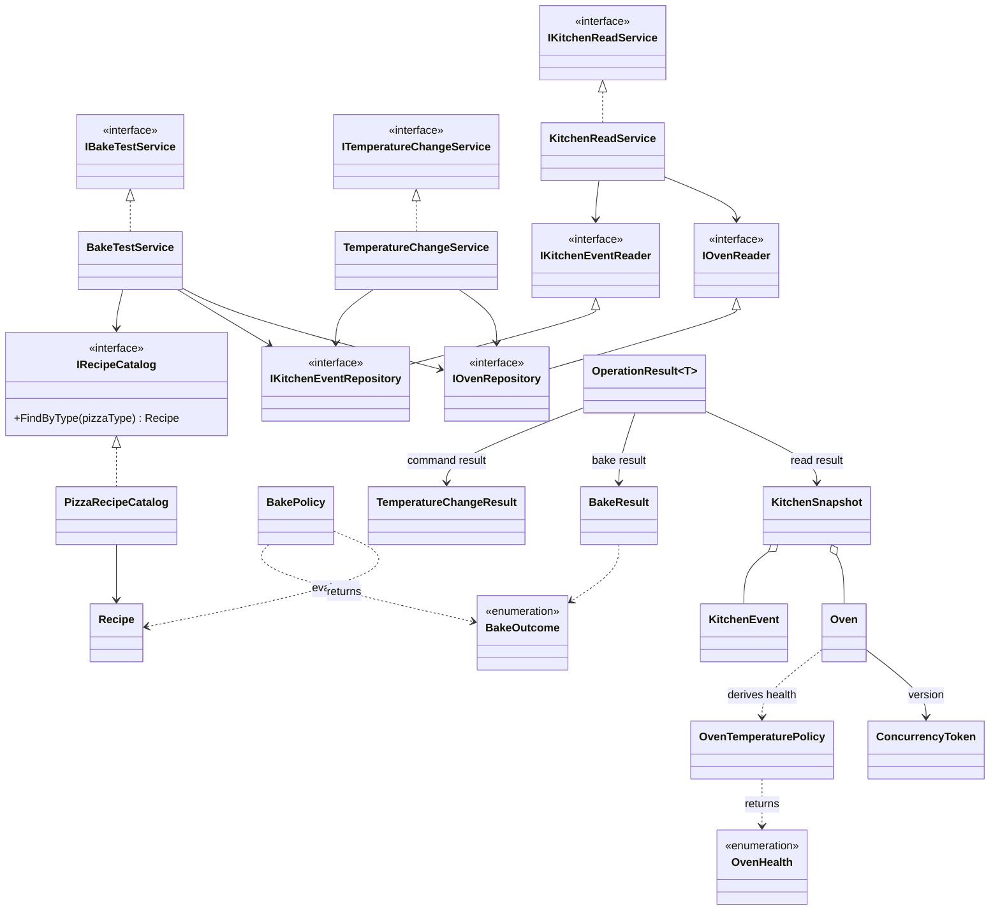

# PizzaOps.Core

## Overview

`PizzaOps.Core` is the dependency-free domain and application layer for the
PizzaOps demo. It targets .NET 10 and contains:

- Domain models and policies for ovens, recipes, temperature commands, and test
  bakes.
- Application services and persistence-facing interfaces, keeping storage and
  hosting concerns outside the core.
- Contracts and stable result codes shared by the Functions host, dashboard,
  storage adapter, and operator utility.

The core has no Azure SDK, web framework, or NuGet package dependencies.
Consumers supply implementations of its repository and reader interfaces.

## Installation

Build the project from the PizzaOps solution directory:

```powershell
dotnet build .\src\PizzaOps.Core\PizzaOps.Core.csproj
```

To use the library from another project in the solution, add a project
reference from that directory:

```powershell
dotnet add .\src\YourProject\YourProject.csproj reference .\src\PizzaOps.Core\PizzaOps.Core.csproj
```

> [!NOTE]
> `PizzaOps.Core` is a project in this repository, not a separately published
> NuGet package.

## Usage

The domain policies can be used without storage or a host. For example, look up
a recipe and evaluate the current oven temperature:

```csharp
using PizzaOps.Core.Domain;

var recipe = PizzaRecipeCatalog.Instance.FindByType(" Margherita ");
if (recipe is null)
{
    throw new InvalidOperationException("The recipe was not found.");
}

var outcome = BakePolicy.Evaluate(recipe, ovenTemperatureC: 450);
Console.WriteLine($"{recipe.DisplayName}: {outcome}");
Console.WriteLine(OvenTemperaturePolicy.IsCommandAllowed(320)); // True
```

Recipe identifiers are normalized for lookup. A completed bake can return
`Pass`, `Undercooked`, or `Burnt`; a non-passing bake is a business outcome, not
an application execution failure.

For storage-backed operations, compose the application services with adapters
for their interfaces. `TemperatureChangeService` and `BakeTestService` accept
oven and event repositories; `KitchenReadService` accepts oven and event
readers. Their results use `OperationResult<T>`, with data and stable codes
defined in `PizzaOps.Core.Contracts`.

## Class diagram


