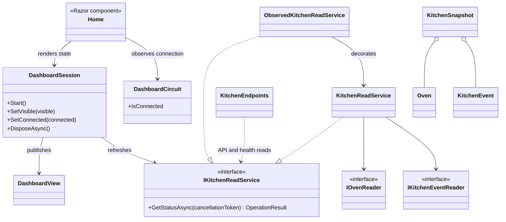

<div align="center">
  

  <h1>PizzaOps Dashboard</h1>

  Read-only live view of persisted PizzaOps kitchen state.
</div>

## Overview

`PizzaOps.Dashboard` is a .NET 10 Blazor Web App with Interactive Server
rendering. It displays the three persisted oven states, backend-computed health,
and up to 20 recent kitchen events. It reads through the shared PizzaOps Core
projection and the Table Storage adapter; it does not call MCP or mutate
kitchen state.

The page refreshes once per second while visible and connected. Reads are
serialized and time-limited, and the dashboard distinguishes live, stale,
unavailable, and event-feed-degraded states rather than inventing sample data.

## Installation

From the PizzaOps solution directory, restore and build the project:

```powershell
dotnet restore .\PizzaOps.sln
dotnet build .\src\PizzaOps.Dashboard\PizzaOps.Dashboard.csproj --no-restore
```

The project requires the .NET 10 SDK. Local execution with Azurite also requires
Azurite; the storage adapter's requirements and configuration are in the
[PizzaOps Storage README](../PizzaOps.Storage/README.md).

## Usage

### Run locally with Azurite

Start the Azurite Table service in a separate terminal:

```powershell
azurite --inMemoryPersistence --tableHost 127.0.0.1 --tablePort 10002
```

From the PizzaOps solution directory, configure the Dashboard to use the local
emulator and run it:

```powershell
$env:PizzaOps__TableStorage__Mode = "Azurite"
$env:PizzaOps__TableStorage__AzuriteConnectionString = "UseDevelopmentStorage=true"
dotnet run --project .\src\PizzaOps.Dashboard
```

The launch profile starts the app in `Development` at
`http://localhost:5144`. The kitchen tables must already exist and contain a
valid initial state; the Dashboard never creates tables or seeds ovens. Use the
[operator reset and status procedure](../../README.md#operator-reset-and-status)
to initialize a disposable local kitchen before opening the page.

### Run against Azure

In a non-Development environment, configure storage with `Mode` set to `Azure`
and an HTTPS Table Storage endpoint. The deployed Dashboard uses its managed
identity; grant it the required Table data-plane read permissions as described
in the [PizzaOps infrastructure guide](../../../../infra/README.md). Do not
configure storage account keys or connection strings for Azure mode.

### Read-only endpoints

With the app running, these endpoints are available:

| Endpoint | Behavior |
| --- | --- |
| `GET /api/kitchen/state` | Returns the oven projection and recent events. Returns `503` when oven state is invalid or unavailable; event-feed degradation is reported separately. |
| `GET /health/live` | Returns `200` when the process is running. |
| `GET /health/ready` | Returns `200` only when all expected ovens and the event feed can be read; otherwise returns `503`. |

For example, from PowerShell:

```powershell
Invoke-RestMethod http://localhost:5144/api/kitchen/state
Invoke-RestMethod http://localhost:5144/health/ready
```

API and health responses use `Cache-Control: no-store`. The dashboard has no
kitchen controls; perform changes or resets through the separately authorized
operator workflow.

## Class diagram


