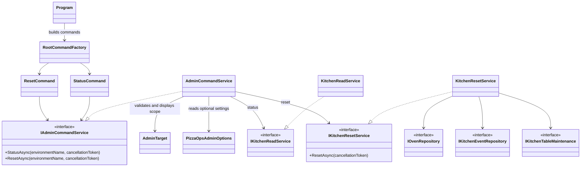

# PizzaOps.DemoAdmin

## Overview

`PizzaOps.DemoAdmin` is a .NET 10 operator CLI for checking and resetting one
explicitly configured PizzaOps kitchen. It uses the shared Core application
services and Table Storage adapter. It is the only supported way to seed or
reset kitchen data; reset is not exposed through MCP, the Functions host, or
the Dashboard.

The CLI has two commands:

- `status` reads the selected kitchen and reports whether its oven state and
  event feed are ready.
- `reset` replaces data in the selected kitchen partition with the canonical
  three-oven state and verifies the result.

## Installation

From the PizzaOps solution directory, restore and build the CLI:

```powershell
dotnet restore .\PizzaOps.sln
dotnet build .\src\PizzaOps.DemoAdmin\PizzaOps.DemoAdmin.csproj --no-restore
```

The project requires the .NET 10 SDK. Local use also requires Azurite; see the
[PizzaOps Storage README](../PizzaOps.Storage/README.md) for starting its Table
service.

## Usage

Run commands from the PizzaOps solution directory:

```powershell
dotnet run --project .\src\PizzaOps.DemoAdmin -- --help
dotnet run --project .\src\PizzaOps.DemoAdmin -- status --environment Development
dotnet run --project .\src\PizzaOps.DemoAdmin -- reset --help
```

Both commands require `--environment` (`-e` is an alias). It selects exactly
one configuration profile and must be 1–32 ASCII letters, digits, hyphens, or
underscores, beginning with a letter or digit. There is no implicit default
environment or fallback to shared `appsettings.json`. The optional
`appsettings.<environment>.json` file is read from the command's current
working directory; prefixed process environment variables override its values.
Prefer environment variables for local-only settings so they are not committed
accidentally.

### Configure local Azurite

For `--environment Development`, the CLI reads
`appsettings.Development.json` and environment variables prefixed with
`PIZZAOPS_DEVELOPMENT_`. Environment variables override values from the file.
Use the local emulator only in Development:

```powershell
$env:PIZZAOPS_DEVELOPMENT_PizzaOps__TableStorage__Mode = "Azurite"
$env:PIZZAOPS_DEVELOPMENT_PizzaOps__TableStorage__AzuriteConnectionString = "UseDevelopmentStorage=true"
$env:PIZZAOPS_DEVELOPMENT_PizzaOps__Admin__DashboardUrl = "http://localhost:5144"
```

The local defaults are `PizzaOpsOvens`, `PizzaOpsEvents`, and the
`main-kitchen` partition. If the kitchen tables do not exist yet, reset creates
them. Keep local-only configuration out of source control.

### Configure Azure

Choose a separate environment name, for example `demo`. The CLI reads
`appsettings.demo.json` and variables prefixed with `PIZZAOPS_DEMO_`:

```powershell
az login
$env:PIZZAOPS_DEMO_PizzaOps__TableStorage__Mode = "Azure"
$env:PIZZAOPS_DEMO_PizzaOps__TableStorage__TableEndpoint = "https://<storage-account>.table.core.windows.net"
$env:PIZZAOPS_DEMO_PizzaOps__Admin__DashboardUrl = "https://<dashboard-hostname>"

dotnet run --project .\src\PizzaOps.DemoAdmin -- status --environment demo
```

Azure mode authenticates with the signed-in Azure CLI operator identity.
`azd auth login` alone is not sufficient. Grant that identity **Storage Table
Data Contributor** on both PizzaOps tables. Configure an HTTPS Table service
endpoint without credentials, path, query, or fragment. Do not provide a
connection string, account key, or `ManagedIdentityClientId`; this CLI does
not use a managed identity for operator access.

The table names and partition can be overridden with the same environment
prefix, for example
`PIZZAOPS_DEMO_PizzaOps__TableStorage__PartitionKey`. `DashboardUrl` is
optional and must be an absolute HTTP(S) URL without user info, query, or
fragment. It is printed for operator convenience only.

### Check status and reset

`status` is read-only. It prints the selected environment, storage mode,
endpoint, tables, partition, and optional Dashboard URL. It reports `READY`
only when the expected ovens and recent event feed are readable; otherwise it
reports `NOT READY` and exits with a non-zero status.

Before resetting, pause MCP callers and wait for all in-flight calls to finish.
Reset deletes rows only from the configured kitchen partition, restores ovens
at 320/450/300 C, appends one `RESET` event, then reads the state back to verify
it. It is not a general storage cleanup command.

```powershell
dotnet run --project .\src\PizzaOps.DemoAdmin -- reset --environment Development --quiesced
dotnet run --project .\src\PizzaOps.DemoAdmin -- status --environment Development
```

`--quiesced` (`-q`) is required to acknowledge that calls are paused and
in-flight calls have drained. Before performing any writes, the CLI prints the
full target scope and asks you to type its exact confirmation phrase. Check
that the environment, endpoint, table names, and partition are the intended
target. A failed reset reports the stage and `NOT READY`; correct the cause,
then rerun reset to converge and verify the kitchen.

## Class diagram


