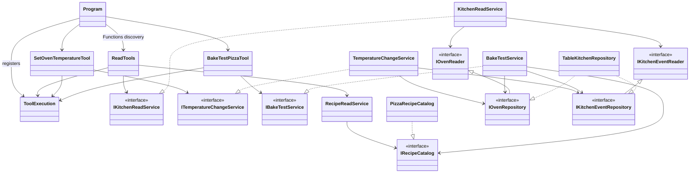

# PizzaOps.Functions

## Overview

`PizzaOps.Functions` is the .NET 10 isolated-worker Azure Functions host for
the PizzaOps MCP server. It exposes four tools over Streamable HTTP and uses
the shared Core application services and Azure Table Storage adapter.

| MCP tool | Purpose |
| --- | --- |
| `get_ovens_status` | Reads the persisted oven temperatures and health. Reports event-feed degradation as a warning. |
| `get_pizza_recipe` | Returns the target temperature and tolerance for `margherita`, `marinara`, or `diavola`. |
| `set_oven_temperature` | Changes an existing oven temperature. The server accepts 200–350 °C and an optional reason of up to 120 characters. |
| `bake_test_pizza` | Evaluates a recipe against the current oven temperature without changing the oven. Attempts to record a `TEST_BAKE` event. |

A completed bake returns `PASS`, `UNDERCOOKED`, or `BURNT`; the latter two
are completed test outcomes, not tool execution failures. Temperature changes
modify shared kitchen state, and all completed bakes may add an event. Use
normal MCP tool approval and ensure the client is connected to the intended
kitchen.

## Installation

From the PizzaOps solution directory, restore and build the Functions project:

```powershell
dotnet restore .\PizzaOps.sln
dotnet build .\src\PizzaOps.Functions\PizzaOps.Functions.csproj --no-restore
```

The project requires the .NET 10 SDK. Local hosting additionally requires
Azure Functions Core Tools 4.x (4.0.7030 or later) and Azurite. See the
[PizzaOps Storage README](../PizzaOps.Storage/README.md) for storage setup.

## Usage

### Run locally

Start Azurite in a separate terminal with Blob, Queue, and Table services
available to the Functions host:

```powershell
azurite --inMemoryPersistence --blobHost 127.0.0.1 --queueHost 127.0.0.1 --tableHost 127.0.0.1
```

From the PizzaOps solution directory, reset the disposable local kitchen and
start the Functions host with its Development launch profile:

```powershell
dotnet run --project .\src\PizzaOps.DemoAdmin -- reset --environment Development --quiesced
dotnet run --project .\src\PizzaOps.Functions
```

Confirm the reset target and type the exact scope phrase when prompted. The
launch profile selects the isolated worker, `Development`, and Azurite; it
contains no Azure credentials and is not used for deployment. The local
Streamable HTTP endpoint is:

```text
http://127.0.0.1:7071/runtime/webhooks/mcp
```

Connect an MCP client to this endpoint to discover and call the tools. For
VS Code/Copilot setup and discovery checks, see the parent
[PizzaOps README](../../README.md#configure-the-mcp-server-in-vs-code).

### Connect to a deployed Function App

The deployed webhook uses **System** authorization. Connect to the Function
App's default hostname at:

```text
https://<function-app-hostname>/runtime/webhooks/mcp
```

Send the Function App system key named `mcp_extension` in the
`x-functions-key` header. Obtain it from **App keys** using an authorized
operator account; an ordinary function key is not a substitute. Keep the key
in a secret store or process environment, never in source control, chat,
command history, or a URL. Azure CLI/AZD sign-in does not authenticate MCP
requests. Follow the parent README for client configuration and safe key
handling.

The Function App accesses Azure Table Storage with its managed identity. Its
storage roles and the root AZD provisioning/deployment workflow are described
in the [PizzaOps infrastructure guide](../../../../infra/README.md).

### Tool behavior

- **Temperature changes:** server-side validation accepts integer commands
  from 200 through 350 °C inclusive. The operation updates an existing oven
  conditionally and records a temperature-change or rejection event. A
  concurrent update is rejected rather than overwritten.
- **Test bakes:** the tool observes the persisted oven once and evaluates the
  recipe's inclusive passing range. It never writes the oven or changes its
  version. Each completed test attempts one `TEST_BAKE` event; the result
  remains available if event recording fails, with an explicit warning.
- **Errors and retries:** responses use stable result codes and correlation
  IDs. If a mutation's storage outcome is uncertain, refresh kitchen state
  before deciding whether to retry; do not retry it automatically.

A typical MCP client workflow is to call `get_ovens_status`, look up a recipe
with `get_pizza_recipe(pizza_type: "margherita")`, and—if a repair is needed—
call `set_oven_temperature(oven_id: "oven-02", target_temperature_c: 320)`.
Then call `bake_test_pizza(oven_id: "oven-02", pizza_type: "margherita")` and
read the status again. The temperature change is a write; the bake does not
change the oven but can append an event.

## Class diagram


